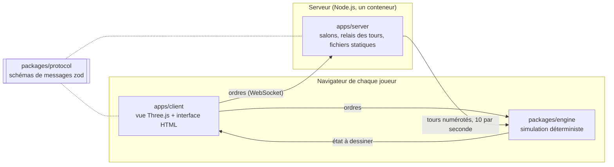

<p align="center">
  <a href="https://nclsmgr.com/frontfall/">
    <picture>
      <source media="(prefers-color-scheme: dark)" srcset="docs/assets/banner-dark.svg">
      
    </picture>
  </a>
</p>

# Frontfall

**Un jeu de stratégie territoriale multijoueur en temps réel, dans le navigateur, sur un monde sans bord.**

[](https://nclsmgr.com/frontfall/)
[](https://github.com/nic0lasm/frontfall/actions/workflows/ci.yml)
[](https://github.com/nic0lasm/frontfall/actions/workflows/codeql.yml)
[](https://scorecard.dev/viewer/?uri=github.com/nic0lasm/frontfall)
[](vitest.config.ts)
[](#en-un-coup-dœil)
[](LICENSE)

[English version](README.md)

## Jouer

La version en cours tourne sur **[nclsmgr.com/frontfall](https://nclsmgr.com/frontfall/)**, sans compte ni installation. Chaque push sur `main` y est déployé en quelques minutes.

Attention : c'est une version de développement, pas encore un jeu. Elle affiche aujourd'hui un monde de test généré, que l'on fait défiler et zoomer sans fin d'est en ouest, connecté en direct au serveur de tours. La première version jouable, v0.1, est une partie solo contre des bots sur une carte de la Terre ; [la feuille de route](#feuille-de-route) donne toute la suite.

## En un coup d'œil

|                   |                                                                                                         |
| ----------------- | ------------------------------------------------------------------------------------------------------- |
| **Le jeu**        | Partir d'une case, dépasser ses voisins, tenir la carte. Parties courtes, sans installation.            |
| **La différence** | Le monde boucle d'est en ouest, et la phase 2 le pose sur un globe 3D. Aucun bord où se cacher.         |
| **État**          | Début de développement. Moteur, relais des tours, rendu de la carte et déploiement sont en place.       |
| **Jouer**         | [nclsmgr.com/frontfall](https://nclsmgr.com/frontfall/), ou votre propre serveur avec une image Docker. |
| **Prérequis**     | Un navigateur de bureau compatible WebGL 2.                                                             |
| **Licence**       | MIT : libre d'y jouer, de le forker et de l'héberger.                                                   |

## Feuille de route

Le développement avance par versions jouables. Chacune se termine par quelque chose de jouable sur le serveur public.

| Version | Objectif                                                                             | État     |
| ------- | ------------------------------------------------------------------------------------ | -------- |
| M0      | Fondations et spécification : squelette du moteur, relais des tours, CI, déploiement | Terminé  |
| v0.1    | Partie solo dans le navigateur contre des bots, sur une carte de la Terre            | En cours |
| v0.2    | En ligne entre amis : liens d'invitation, client lockstep, détection des désyncs     | En cours |
| v0.3    | Jeu plus riche : villes et forts, alliances, nations, relief, reconnexion            | Prévu    |
| v0.4    | Mer et missiles : navires, combat naval, missiles, parties en équipes, replays       | Prévu    |
| v1.0    | Première version publique : équilibrage et serveur surveillé                         | Prévu    |
| M6      | Globe 3D                                                                             | Prévu    |
| M7      | Performance, et bascule entre carte et globe en cours de partie                      | Prévu    |
| M8      | Communauté et lancement                                                              | Prévu    |

Le périmètre et les critères « jouable » de chaque version sont dans [docs/roadmap.md](docs/roadmap.md) (en anglais). Le travail ouvert est suivi dans les [milestones](https://github.com/nic0lasm/frontfall/milestones).

## Comment ça marche

Chaque client fait tourner la même simulation. Le serveur ne calcule jamais la partie : il recueille les ordres de chaque joueur, les numérote en tours dix fois par seconde et envoie les mêmes tours à tout le monde. Mêmes entrées sur un moteur déterministe, même partie, pour une fraction de la bande passante qu'exigerait l'envoi de l'état.



| Choix                       | Pourquoi                                                                                                       |
| --------------------------- | -------------------------------------------------------------------------------------------------------------- |
| TypeScript strict           | Un seul langage pour le moteur, le client et le serveur                                                        |
| Lockstep déterministe       | Calcul entier et générateur à graine ; les règles de lint interdisent l'horloge et `Math.random`               |
| Grille du monde cylindrique | Pas de bord gauche ni droit dès aujourd'hui ; le globe change la projection, pas les règles                    |
| Three.js                    | Rendu WebGL qui passe de la carte plate au globe                                                               |
| Schémas zod                 | Chaque message est validé à l'arrivée, des deux côtés                                                          |
| Un seul petit conteneur     | Système de fichiers en lecture seule, utilisateur non root, image multi-arch analysée avant chaque publication |

Chaque choix est justifié dans une fiche de décision d'architecture, dans [docs/adr](docs/adr/), et les budgets de durée de tick, de temps de rendu et de mémoire imposés au moteur et au rendu sont dans [docs/performance.md](docs/performance.md) (en anglais). Les messages échangés sur la WebSocket sont décrits dans [docs/protocol.md](docs/protocol.md) (en anglais). Les cartes sont générées à partir des données [Natural Earth](https://www.naturalearthdata.com/), du domaine public, par `pnpm maps` ([docs/maps.md](docs/maps.md), en anglais), au format décrit dans [docs/map-format.md](docs/map-format.md) (en anglais).

## Lancer en local

Prérequis : Node.js 24 LTS et pnpm 10, fourni par `corepack enable`.

```sh
git clone https://github.com/nic0lasm/frontfall.git
cd frontfall
corepack enable
pnpm install
pnpm dev        # client sur http://localhost:5173, serveur sur :8080
```

| Commande             | Rôle                                                      |
| -------------------- | --------------------------------------------------------- |
| `pnpm test`          | Tests unitaires (Vitest)                                  |
| `pnpm test:coverage` | Tests avec couverture ; la CI échoue sous 90 % des lignes |
| `pnpm lint`          | ESLint avec règles typées                                 |
| `pnpm typecheck`     | TypeScript en mode strict, pour chaque paquet             |
| `pnpm build`         | Client de production et serveur empaqueté                 |

### Héberger son propre serveur

L'image publiée sert le client et le relais des tours sur un seul port :

```sh
docker run --rm -p 8080:8080 ghcr.io/nic0lasm/frontfall:latest   # http://localhost:8080
```

Derrière un reverse proxy, le jeu fonctionne à la racine d'un domaine ou sous un sous-chemin comme `/frontfall`, à condition de transmettre les upgrades WebSocket. Pour construire l'image soi-même : `docker build -t frontfall .`

## Contribuer

Frontfall se construit en public et toute contribution est bienvenue, quelle que soit sa taille : code, cartes, retours d'équilibrage, traductions, rapports de bug.

1. **Jouez à la version en cours** et [signalez ce qui casse](https://github.com/nic0lasm/frontfall/issues/new/choose).
2. **Choisissez une première tâche** parmi les issues marquées [`good first issue`](https://github.com/nic0lasm/frontfall/labels/good%20first%20issue) ou [`help wanted`](https://github.com/nic0lasm/frontfall/labels/help%20wanted), et laissez un commentaire pour que personne ne fasse le travail en double.
3. **Discutez avant de construire** quoi que ce soit d'important dans les [Discussions](https://github.com/nic0lasm/frontfall/discussions), catégorie Ideas.
4. **Ouvrez une pull request** en suivant [CONTRIBUTING.md](CONTRIBUTING.md) (en anglais). La CI lance les mêmes vérifications que `pnpm test:coverage`, `pnpm lint` et `pnpm build`.

Les failles de sécurité se signalent en privé, comme l'explique [SECURITY.md](SECURITY.md). Chaque participant respecte le [code de conduite](CODE_OF_CONDUCT.md).

## Communauté

- [Discussions](https://github.com/nic0lasm/frontfall/discussions) : questions, idées, propositions de cartes, notes de développement. Le français y est bienvenu.
- [Releases](https://github.com/nic0lasm/frontfall/releases) : ce qui change à chaque version, en clair. Suivez le dépôt avec « Watch > Custom > Releases » pour être prévenu.
- [CHANGELOG.md](CHANGELOG.md) : chaque changement fusionné, du plus récent au plus ancien.

Si la direction vous plaît, une étoile aide d'autres joueurs à trouver le projet.

## Inspiration et mentions légales

Frontfall est un jeu indépendant inspiré d'OpenFront. Il n'est ni affilié à OpenFront ni approuvé par OpenFront. Il ne contient aucun code ni aucun asset d'OpenFront. Les règles du jeu sont écrites de zéro dans [docs/rules.md](docs/rules.md) (en anglais), selon une [politique de salle blanche](docs/clean-room.md) vérifiée par la CI, et chaque bibliothèque ou jeu de données tiers est listé dans [CREDITS.md](CREDITS.md) avec sa licence.

## Licence

[MIT](LICENSE) © 2026 Nicolas Maigre. Le nom et le logo Frontfall ne sont pas couverts par la licence du code ; leur usage est décrit dans le [guide de marque](docs/brand.md) (en anglais).
