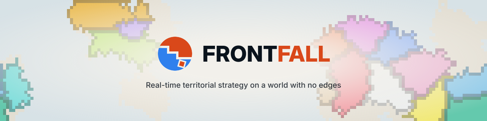
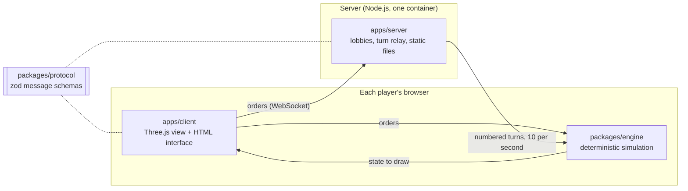

<p align="center">
  <a href="https://nclsmgr.com/frontfall/">
    <picture>
      <source media="(prefers-color-scheme: dark)" srcset="docs/assets/banner-dark.svg">
      
    </picture>
  </a>
</p>

# Frontfall

**A real-time multiplayer territorial strategy game, played in the browser on a world with no edges.**

[](https://nclsmgr.com/frontfall/)
[](https://github.com/nic0lasm/frontfall/actions/workflows/ci.yml)
[](https://github.com/nic0lasm/frontfall/actions/workflows/codeql.yml)
[](https://scorecard.dev/viewer/?uri=github.com/nic0lasm/frontfall)
[](vitest.config.ts)
[](#at-a-glance)
[](LICENSE)

[Version française](README.fr.md)

## Play now

The current build runs at **[nclsmgr.com/frontfall](https://nclsmgr.com/frontfall/)**, no account and no install. Every push to `main` is deployed there within minutes.

Be warned: this is a development build, not a game yet. Today it shows a generated test world that you can drag and zoom endlessly east to west, connected live to the turn server. The rules engine arrives with M1 and the first solo game in the browser with M3; [the roadmap](#roadmap) has the full sequence.

## At a glance

|                  |                                                                                                    |
| ---------------- | -------------------------------------------------------------------------------------------------- |
| **What it is**   | Spread from a single tile, outgrow your neighbours, hold the map. Short rounds, no install.        |
| **The twist**    | The world wraps east to west, and phase 2 puts it on a 3D globe. There is no edge to hide behind.  |
| **Status**       | Early development. Engine foundations, turn relay, map renderer and deployment are in place.       |
| **Play**         | [nclsmgr.com/frontfall](https://nclsmgr.com/frontfall/), or your own server with one Docker image. |
| **Requirements** | A desktop browser with WebGL 2.                                                                    |
| **License**      | MIT, free to play, fork and host.                                                                  |

## Roadmap

Development runs in milestones. Each one ends with something you can try on the public server.

| Milestone | Goal                                                                                   | Status      |
| --------- | -------------------------------------------------------------------------------------- | ----------- |
| M0        | Foundations and specification: engine skeleton, turn relay, CI, deployment, game rules | In progress |
| M1        | Simulation core: territory, troops and attacks, tested headless                        | Planned     |
| M2        | Maps from open geographic data                                                         | Planned     |
| M3        | Solo game in the browser, against bots                                                 | Planned     |
| M4        | Online multiplayer: public lobbies, rejoin, desync detection                           | Planned     |
| M5        | Full game and v1.0, the first public release                                           | Planned     |
| M6        | 3D globe                                                                               | Planned     |
| M7        | Performance, and switching between map and globe during a game                         | Planned     |
| M8        | Community and launch                                                                   | Planned     |

The scope and exit criteria of each milestone are in [docs/roadmap.md](docs/roadmap.md). Open work is tracked in [milestones](https://github.com/nic0lasm/frontfall/milestones).

## How it works

Every client runs the same simulation. The server never computes the game: it collects each player's orders, numbers them into turns ten times per second, and sends the same turns to everyone. Identical inputs on a deterministic engine give identical games, for a fraction of the bandwidth of streaming the state.



| Choice                 | Why                                                                                 |
| ---------------------- | ----------------------------------------------------------------------------------- |
| TypeScript, strict     | One language for engine, client and server                                          |
| Deterministic lockstep | Integer maths and a seeded generator; lint rules forbid the clock and `Math.random` |
| Cylindrical world grid | No left or right edge today; the globe changes the projection, not the rules        |
| Three.js               | WebGL rendering that scales from the flat map to the globe                          |
| zod schemas            | Every message is validated on arrival, on both sides                                |
| Single small container | Read-only filesystem, non-root user, multi-arch image scanned before every release  |

Each choice is argued in an architecture decision record under [docs/adr](docs/adr/).

## Run it locally

Requirements: Node.js 24 LTS (22.12 at minimum) and pnpm 10, which `corepack enable` provides.

```sh
git clone https://github.com/nic0lasm/frontfall.git
cd frontfall
corepack enable
pnpm install
pnpm dev        # client on http://localhost:5173, server on :8080
```

| Command              | What it does                                      |
| -------------------- | ------------------------------------------------- |
| `pnpm test`          | Unit tests (Vitest)                               |
| `pnpm test:coverage` | Tests with coverage; CI fails below 90 % of lines |
| `pnpm lint`          | ESLint with type-aware rules                      |
| `pnpm typecheck`     | TypeScript in strict mode, every package          |
| `pnpm build`         | Production client and bundled server              |

### Host your own server

The published image serves the client and the turn relay on one port:

```sh
docker run --rm -p 8080:8080 ghcr.io/nic0lasm/frontfall:latest   # http://localhost:8080
```

Behind a reverse proxy, the game works at the root of a domain or under a sub-path such as `/frontfall`, with WebSocket upgrades forwarded. To build the image yourself: `docker build -t frontfall .`

## How to contribute

Frontfall is built in the open and contributions of every size are welcome: code, maps, balance feedback, translations, bug reports.

1. **Play the current build** and [report what breaks](https://github.com/nic0lasm/frontfall/issues/new/choose).
2. **Pick a starter task** among the issues labelled [`good first issue`](https://github.com/nic0lasm/frontfall/labels/good%20first%20issue) or [`help wanted`](https://github.com/nic0lasm/frontfall/labels/help%20wanted), and leave a comment so nobody duplicates the work.
3. **Discuss before building** anything large in [Discussions](https://github.com/nic0lasm/frontfall/discussions), under Ideas.
4. **Open a pull request** following [CONTRIBUTING.md](CONTRIBUTING.md). CI runs the same checks as `pnpm test:coverage`, `pnpm lint` and `pnpm build`.

Security issues are reported privately, as described in [SECURITY.md](SECURITY.md). Everyone taking part follows the [Code of Conduct](CODE_OF_CONDUCT.md).

## Community

- [Discussions](https://github.com/nic0lasm/frontfall/discussions): questions, ideas, map proposals, development notes.
- [Releases](https://github.com/nic0lasm/frontfall/releases): what changed in each version, in plain words. Watch the repository with "Custom > Releases" to be notified.
- [CHANGELOG.md](CHANGELOG.md): every merged change, newest first.

If you like where this is going, a star helps other players find the project.

## Inspiration and legal

Frontfall is an independent game inspired by OpenFront. It is not affiliated with or endorsed by OpenFront. It contains no code or assets from OpenFront. Game rules are written from scratch in [docs/rules.md](docs/rules.md) under a [clean-room policy](docs/clean-room.md) that CI enforces, and every third-party library or dataset is listed in [CREDITS.md](CREDITS.md) with its license.

## License

[MIT](LICENSE) © 2026 Nicolas Maigre. The Frontfall name and logo are not covered by the code license; how to use them is described in the [brand guide](docs/brand.md).
