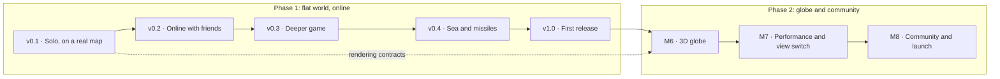

# Roadmap

Frontfall is built in two phases. Phase 1 delivers the game on a flat map that wraps east to west, playable online at [nclsmgr.com/frontfall](https://nclsmgr.com/frontfall/). Phase 2 (M6 to M8) puts the same game on a 3D globe and opens it to contributors. The rules do not change between the two: the globe is a new view, not a new game.

Phase 1 ships as a series of playable versions instead of one release at the end. Each version is something a person can open and play on the public server, and each one says exactly what "playable" means for it. The work that does not serve the next version waits for a later one.

## Overview

| Version                                                              | You can                                                                                     | Issues | Estimate |
| -------------------------------------------------------------------- | ------------------------------------------------------------------------------------------- | -----: | -------: |
| [v0.1 · Solo, on a real map](#v01--solo-on-a-real-map)               | Open the site, spawn on a map of the Earth, expand and fight bots until you win or lose.    |     24 |  72 days |
| [v0.2 · Online with friends](#v02--online-with-friends)              | Share a link, two to eight friends join, and the same game plays out on every screen.       |      8 |  24 days |
| [v0.3 · Deeper game](#v03--deeper-game)                              | Build cities and forts, ally and betray, face named nations on relief, rejoin after a drop. |     11 |  31 days |
| [v0.4 · Sea and missiles](#v04--sea-and-missiles)                    | Sail from ports, fight at sea, launch missiles, play in teams and watch replays.            |      5 |  19 days |
| [v1.0 · First release](#v10--first-release)                          | A balanced, monitored public release.                                                       |      3 |   5 days |
| [M6 · 3D globe](#m6--3d-globe)                                       | The same game on a planet you can spin. No edge, no seam.                                   |      7 |  21 days |
| [M7 · Performance and view switch](#m7--performance-and-view-switch) | Smooth on a modest laptop, and switch between the flat map and the globe mid-game.          |      8 |  20 days |
| [M8 · Community and launch](#m8--community-and-launch)               | Players and contributors find the game, add maps and translations, and follow each release. |      7 |  13 days |

M0 (foundations and specification) is done: repository, rules, CI, container image and deployment are in place.

A solid arrow means the later version cannot ship before the earlier one. Work on a later version can start early when it does not compete with the current one: the relay server and the lobby protocol of v0.2 need nothing from the client and are built alongside v0.1, and the globe renderer (M6-01) can start as soon as the rendering contracts of v0.1 (M3-01) exist.

## How to read this page

Each version has a player outcome, a "Playable when" list that decides when it ships, and the issues that get it there. A version ships when every check passes, not when its issues are closed. It is tagged (`v0.1.0`, `v0.2.0`, ...), deployed to the public server and described in the [changelog](../CHANGELOG.md).

| Size | Meaning                                                  |
| ---- | -------------------------------------------------------- |
| S    | About 1 day                                              |
| M    | 2 to 3 days                                              |
| L    | 4 to 5 days. Anything larger is split before work starts |

Estimates add up S = 1, M = 3 and L = 5 days of focused work. They measure scope, not a calendar: the engine, maps, client and server move in parallel, so a version takes less time than its total. There are no dates on this page.

Issue IDs such as `M3-01` were given when the work was first split into milestones M1 to M5. They stay as stable references in issue bodies and commits; the prefix no longer says which version an issue belongs to. GitHub milestones carry the version.

Gameplay issues implement the rules of [`docs/rules.md`](rules.md) by identifier (`R-ATTACK-01`) and take every number from [`docs/balance.md`](balance.md). Architecture choices are recorded in [`docs/adr/`](adr/).

## v0.1 · Solo, on a real map

**Outcome.** Open the site, spawn on a map of the Earth, expand and fight bots until you win or lose.

**Playable when**

1. From the public server, a player starts a solo game on the World map with 8 or more bots in two clicks, picks a start tile, expands, attacks and reaches the end screen, by winning (`R-WIN-01`) or by being eliminated.
2. On the World map, a player sends troops by sea from their coast to another continent and takes land there; bots do the same.
3. The same run passes as a Playwright test in Chromium and Firefox with no console error, in CI and against the public server after deployment.
4. A scripted game of 10,000 ticks with 8 bots on the World map gives the same final state hash twice in Node.js and once in Chromium.
5. The engine runs in a Web Worker behind the game session interface, and the page stays responsive during the game.
6. Three people outside the project each finish a game without help; what blocked them is filed as issues.

**Rules in scope.** `R-MAP-01` to `R-MAP-04` (land, water and impassable ice; relief is drawn but costs nothing extra yet), `R-SPAWN`, `R-ECO-01` to `R-ECO-05` (cities aside), `R-ATTACK-01` to `R-ATTACK-09`, `R-UNIT-01` and a minimal `R-UNIT-02` (troops leave from any owned coast, without a port, and nothing can stop them at sea), `R-BOT-01`, `R-BOT-03`, `R-BOT-04`, `R-WIN-01` to `R-WIN-03`, `R-MODE-01`, `R-FAIR-02`.

**Left for later on purpose.** The full map set, French, relief costs, nations, structures, ports and fighting at sea.

Without transport by sea, players on two continents never meet, so a minimal version of it is part of v0.1. Ports, warships and interception stay in v0.4.

| ID    | Issue                                                                                                   | Size | Depends on |
| ----- | ------------------------------------------------------------------------------------------------------- | ---- | ---------- |
| M1-01 | [#4](https://github.com/nic0lasm/frontfall/issues/4) Topology interface with flat and cylinder modes    | M    | None       |
| M1-02 | [#5](https://github.com/nic0lasm/frontfall/issues/5) Deterministic integer maths helpers                | S    | None       |
| M1-03 | [#6](https://github.com/nic0lasm/frontfall/issues/6) Game state and tick loop                           | M    | #4, #5     |
| M1-04 | [#7](https://github.com/nic0lasm/frontfall/issues/7) Intent validation and execution                    | M    | #6         |
| M1-05 | [#8](https://github.com/nic0lasm/frontfall/issues/8) Spawn phase                                        | S    | #7         |
| M1-06 | [#9](https://github.com/nic0lasm/frontfall/issues/9) Population, troops and gold growth                 | M    | #6         |
| M1-07 | [#10](https://github.com/nic0lasm/frontfall/issues/10) Expansion into neutral land                      | L    | #7, #9     |
| M1-08 | [#11](https://github.com/nic0lasm/frontfall/issues/11) Attacks between players                          | L    | #10        |
| M1-11 | [#14](https://github.com/nic0lasm/frontfall/issues/14) Game session runner, in the page and headless    | M    | #7         |
| M1-10 | [#13](https://github.com/nic0lasm/frontfall/issues/13) Run the engine in a Web Worker                   | M    | #14        |
| M2-01 | [#15](https://github.com/nic0lasm/frontfall/issues/15) Map format v1 specification                      | S    | None       |
| M2-02 | [#16](https://github.com/nic0lasm/frontfall/issues/16) Map loader in the engine                         | M    | #15, #6    |
| M2-03 | [#17](https://github.com/nic0lasm/frontfall/issues/17) Map generator: land and water from Natural Earth | L    | #15        |
| M2-05 | [#19](https://github.com/nic0lasm/frontfall/issues/19) Coasts, small islands and the east-west seam     | M    | #17        |
| M3-01 | [#23](https://github.com/nic0lasm/frontfall/issues/23) Renderer and Camera contracts                    | M    | #14        |
| M3-02 | [#24](https://github.com/nic0lasm/frontfall/issues/24) Territory rendering with a data texture          | L    | #23, #16   |
| M3-03 | [#25](https://github.com/nic0lasm/frontfall/issues/25) Mouse, touch and keyboard input                  | M    | #23        |
| M3-04 | [#26](https://github.com/nic0lasm/frontfall/issues/26) In-game interface                                | M    | #24        |
| M3-05 | [#27](https://github.com/nic0lasm/frontfall/issues/27) Main menu and game setup                         | M    | #16        |
| M3-06 | [#28](https://github.com/nic0lasm/frontfall/issues/28) Bots                                             | L    | #11, #8    |
| M3-08 | [#30](https://github.com/nic0lasm/frontfall/issues/30) Victory, defeat and end screen                   | S    | #11        |
| M3-11 | [#33](https://github.com/nic0lasm/frontfall/issues/33) First playtest round                             | S    | #30        |
| M1-12 | [#81](https://github.com/nic0lasm/frontfall/issues/81) Minimal sea transport                            | M    | #11        |
| M3-12 | [#82](https://github.com/nic0lasm/frontfall/issues/82) Smooth territory and front updates               | M    | #24        |

24 issues, about 72 days of work in four parallel streams: engine (30), maps (12), client (25) and bots (5). The worker is in v0.1 because the engine and the renderer share the page otherwise: a tick takes up to 9 ms on the World map, and moving the session later would mean writing it twice.

## v0.2 · Online with friends

**Outcome.** Share a link, two to eight friends join, and the same game plays out on every screen.

**Playable when**

1. A player creates a private game from the menu, picks one of at least three maps and a number of bots, and shares the link; the others join from it.
2. Four players on two networks and two browsers finish a game on `nclsmgr.com/frontfall` with zero desyncs.
3. A deliberate desync in a test is detected within 10 seconds and reported to the server with the tick and both hashes.
4. A scripted 4-player game ends with the same state hash in Node.js, Chromium, Firefox and WebKit, checked in CI.
5. Every map rebuilds byte for byte from its pinned sources, checked in CI.

| ID    | Issue                                                                                                      | Size | Depends on |
| ----- | ---------------------------------------------------------------------------------------------------------- | ---- | ---------- |
| M1-09 | [#12](https://github.com/nic0lasm/frontfall/issues/12) State hash and cross-runtime determinism suite      | M    | #11        |
| M2-07 | [#21](https://github.com/nic0lasm/frontfall/issues/21) First map set                                       | M    | #19        |
| M2-08 | [#22](https://github.com/nic0lasm/frontfall/issues/22) Map build and checksum check in CI                  | S    | #21        |
| M4-01 | [#34](https://github.com/nic0lasm/frontfall/issues/34) Protocol v1: version handshake and compact encoding | M    | None       |
| M4-02 | [#35](https://github.com/nic0lasm/frontfall/issues/35) Lobby lifecycle                                     | M    | #34        |
| M4-03 | [#36](https://github.com/nic0lasm/frontfall/issues/36) Public games list and private invite links          | M    | #35, #27   |
| M4-04 | [#37](https://github.com/nic0lasm/frontfall/issues/37) Lockstep client                                     | L    | #13, #34   |
| M4-05 | [#38](https://github.com/nic0lasm/frontfall/issues/38) Desync detection and reports                        | M    | #12, #37   |

8 issues, about 24 days. The protocol and the lobby (#34, #35) start during v0.1.

## v0.3 · Deeper game

**Outcome.** Build cities and forts, ally and betray, face named nations on hills and mountains, and rejoin a game after a dropped connection.

**Playable when**

1. Every rule of `R-MAP`, `R-BUILD-01`, `R-BUILD-03`, `R-BUILD-06`, `R-DIPLO-01` to `R-DIPLO-05` and `R-BOT-02` is implemented and covered by a test that names it.
2. A player who loses the connection for 30 seconds rejoins and catches up in under 10 seconds.
3. Load test: 20 games of 16 simulated players hold for 30 minutes under 50 % of one vCPU and 512 MB on the server; fuzzed and oversized messages never crash it or affect other games.
4. Every interface string exists in English and French.

| ID    | Issue                                                                                              | Size | Depends on |
| ----- | -------------------------------------------------------------------------------------------------- | ---- | ---------- |
| M2-04 | [#18](https://github.com/nic0lasm/frontfall/issues/18) Relief and impassable terrain               | M    | #17        |
| M2-06 | [#20](https://github.com/nic0lasm/frontfall/issues/20) Manifests, thumbnails and nation positions  | M    | #19        |
| M3-07 | [#29](https://github.com/nic0lasm/frontfall/issues/29) Nations                                     | M    | #28, #20   |
| M3-09 | [#31](https://github.com/nic0lasm/frontfall/issues/31) English and French interface                | S    | None       |
| M3-10 | [#32](https://github.com/nic0lasm/frontfall/issues/32) Settings and accessibility                  | S    | #26        |
| M4-06 | [#39](https://github.com/nic0lasm/frontfall/issues/39) Reconnection and catch-up                   | L    | #37        |
| M4-07 | [#40](https://github.com/nic0lasm/frontfall/issues/40) Abuse protection on the game server         | M    | #35        |
| M4-08 | [#41](https://github.com/nic0lasm/frontfall/issues/41) Server metrics and structured logs          | S    | #35        |
| M4-09 | [#42](https://github.com/nic0lasm/frontfall/issues/42) Load test and message fuzzing               | M    | #37, #40   |
| M5-01 | [#43](https://github.com/nic0lasm/frontfall/issues/43) Structures: cities, ports and defence posts | L    | #26        |
| M5-05 | [#47](https://github.com/nic0lasm/frontfall/issues/47) Alliances, betrayal and embargoes           | M    | #26        |

11 issues, about 31 days.

## v0.4 · Sea and missiles

**Outcome.** Sail from ports, fight at sea, launch missiles, play in teams and watch a game again.

**Playable when**

1. Every rule of `docs/rules.md` v1 is implemented and covered by a test that names it.
2. A team game of 4 against 4 is played to the end on the public server.
3. A finished game can be replayed from its link and ends with the same hash.

| ID    | Issue                                                                                        | Size | Depends on |
| ----- | -------------------------------------------------------------------------------------------- | ---- | ---------- |
| M5-02 | [#44](https://github.com/nic0lasm/frontfall/issues/44) Transport boats and water pathfinding | L    | #43, #81   |
| M5-03 | [#45](https://github.com/nic0lasm/frontfall/issues/45) Warships and naval combat             | M    | #44        |
| M5-04 | [#46](https://github.com/nic0lasm/frontfall/issues/46) Missiles and air defence              | L    | #43        |
| M5-06 | [#48](https://github.com/nic0lasm/frontfall/issues/48) Team games                            | M    | #35, #47   |
| M5-08 | [#50](https://github.com/nic0lasm/frontfall/issues/50) Replays                               | M    | #38        |

5 issues, about 19 days.

## v1.0 · First release

**Outcome.** A balanced, monitored public release.

**Playable when**

1. Tag `v1.0.0` with release notes, the matching image on GHCR and the build live on `nclsmgr.com/frontfall`.
2. The public server stays above 99 % uptime over the 14 days before the announcement, measured by an external check.
3. The README shows screenshots and a short clip of a real game.

| ID    | Issue                                                                                   | Size | Depends on    |
| ----- | --------------------------------------------------------------------------------------- | ---- | ------------- |
| M5-07 | [#49](https://github.com/nic0lasm/frontfall/issues/49) Balance pass with headless games | M    | #45, #46, #47 |
| M5-09 | [#51](https://github.com/nic0lasm/frontfall/issues/51) Uptime monitoring and alerts     | S    | None          |
| M5-10 | [#52](https://github.com/nic0lasm/frontfall/issues/52) Release v1.0                     | S    | #49, #50, #51 |

3 issues, about 5 days.

## M6 · 3D globe

**Outcome.** The same game on a planet you can spin. No edge, no seam.

**Done when**

1. A full multiplayer game is playable in the globe view with the same state hashes as the 2D view.
2. At every zoom level, a click on the globe selects the tile under the cursor (automated test on 1,000 random points).
3. No visible seam at 180 degrees and no texture stretching shown at the poles, which are ice caps.
4. 45 frames per second or more on the reference laptop at 1080p on the World map.

| ID    | Issue                                            | Size | Depends on   |
| ----- | ------------------------------------------------ | ---- | ------------ |
| M6-01 | Globe renderer on the Renderer contract          | M    | M3-01        |
| M6-02 | Territory texture on the sphere                  | M    | M6-01, M3-02 |
| M6-03 | Orbital camera                                   | M    | M6-01        |
| M6-04 | Ray-sphere picking                               | S    | M6-03, M1-01 |
| M6-05 | Units, structures and trajectories on the sphere | L    | M6-02, M5-04 |
| M6-06 | Labels and interface over the globe              | M    | M6-02        |
| M6-07 | Globe maps                                       | M    | M2-08        |

7 issues, about 21 days.

## M7 · Performance and view switch

**Outcome.** Smooth on a modest laptop, and players switch between the flat map and the globe in the middle of a game.

**Done when**

1. Budgets from `docs/performance.md` met on the reference laptop: 60 fps in 2D, 45 fps on the globe, 1080p, World map, 64 players.
2. Tick p95 under 8 ms for 64 players on the 4,096 x 2,048 map.
3. Client memory under 500 MB; first load under 5 MB compressed before the map.
4. Switching view keeps the game running and takes under 500 ms.

| ID    | Issue                                           | Size | Depends on   |
| ----- | ----------------------------------------------- | ---- | ------------ |
| M7-01 | Performance budget and reference hardware       | S    | None         |
| M7-02 | Benchmark regression gate in CI                 | M    | M7-01, M1-11 |
| M7-03 | Engine hot paths                                | L    | M7-02        |
| M7-04 | Cheaper updates from the worker to the renderer | M    | M7-02        |
| M7-05 | Rendering levels of detail                      | M    | M6-05        |
| M7-06 | Graphics quality settings                       | S    | M7-05        |
| M7-07 | Switch between map and globe during a game      | M    | M6-04, M7-04 |
| M7-08 | Download size and load time                     | S    | M6-01        |

8 issues, about 20 days.

## M8 · Community and launch

**Outcome.** Players and contributors find the game, add maps and translations, and follow each release.

**Done when**

1. A person outside the project adds a map by following the guide alone, and it is merged.
2. At least 10 open issues labelled `good first issue`, each with a clear scope and pointers.
3. Each tag publishes release notes generated from the commit history.
4. The launch announcement is published on the planned channels.

| ID    | Issue                          | Size | Depends on   |
| ----- | ------------------------------ | ---- | ------------ |
| M8-01 | Map contribution workflow      | M    | M2-08        |
| M8-02 | Translation workflow           | S    | M3-09        |
| M8-03 | Release notes automation       | S    | None         |
| M8-04 | Good first issues backlog      | S    | None         |
| M8-05 | Contributor architecture guide | M    | None         |
| M8-06 | Game landing and about page    | M    | M5-10        |
| M8-07 | Launch announcement            | S    | M7-07, M8-06 |

7 issues, about 13 days.

## Good first issues

Small issues opened for newcomers (keyboard panning, zoom towards the cursor, WebGL 2 message, link previews, touch controls, protocol documentation) carry no version. Any of them is welcome at any time and ships with the next tag after it is merged.

## Not planned yet

Player accounts, ranked matchmaking, cosmetics and payments, native mobile apps and servers in several regions are left out on purpose. They will be considered after v1.0 based on what players ask for in [Discussions](https://github.com/nic0lasm/frontfall/discussions).

## Legal

Frontfall is an independent game inspired by browser territory games such as OpenFront. It is not affiliated with or endorsed by OpenFront and contains no code, assets or text from it. Map data comes from public-domain sources listed in [`CREDITS.md`](../CREDITS.md).
