# Roadmap

Frontfall is built in two phases. Phase 1 (v0.1 to v0.9) delivers the game on a flat map that wraps east to west, playable online at [nclsmgr.com/frontfall](https://nclsmgr.com/frontfall/), and makes it steady and good to look at: deployments that do not cut games, balance tuned on real games, phones, a full visual redesign, rules of its own, performance under load, sound and a polished first visit. Phase 2 (v0.9.x to v1.0) puts the same game on a 3D globe, right after v0.9.0, then opens it to community maps. The rules do not change between the two: the globe is a new view, not a new game.

The game is in beta until v1.0, and its page says so. v1.0 is the first version that is a complete territory strategy game, played on the 3D globe, on a server that is run like a product.

The game ships as a series of playable versions instead of one release at the end. Each version is something a person can open and play on the public server, and each one says exactly what "playable" means for it. The work that does not serve the next version waits for a later one.

**Where it stands.** v0.1 to v0.4 are live: a solo game against bots, online games with friends on eight maps and three generated quick maps, structures, diplomacy and nations, then the sea, missiles, teams and replays. v0.3 and v0.4 were released together as `v0.4.0` on 25 October 2026, with every rule of v1 in the game. People I do not know now play it every day, so the next versions put running the game first: v0.5 makes deployments harmless and measures how games actually go, before any balance number changes. The globe moves from v0.6 to v0.9.x, the first releases after v0.9.0, after a redesign of the look (v0.7) and rules that are Frontfall's own (v0.8), so that the globe shows the final game. [Changes after v0.4](#changes-after-v04) and [Changes after v0.4.1](#changes-after-v041) say what moved and why.

## Overview

| Version                                                                | You can                                                                                                                                  | Status  | Issues | Estimate |
| ---------------------------------------------------------------------- | ---------------------------------------------------------------------------------------------------------------------------------------- | ------- | -----: | -------: |
| [v0.1 · Solo, on a real map](#v01--solo-on-a-real-map)                 | Open the site, spawn on a map of the Earth, expand and fight bots until you win or lose.                                                 | Shipped |     23 |  71 days |
| [v0.2 · Online with friends](#v02--online-with-friends)                | Share a link, two to eight friends join, and the same game plays out on every screen.                                                    | Shipped |      8 |  24 days |
| [v0.3 · Deeper game](#v03--deeper-game)                                | Build cities and forts, ally and betray, face named nations, on a watched server.                                                        | Shipped |     12 |  24 days |
| [v0.4 · Sea and missiles](#v04--sea-and-missiles)                      | Sail from ports, fight at sea, launch missiles, play in teams and watch replays.                                                         | Shipped |      6 |  19 days |
| [v0.4.x · Fixes](#v04x--fixes)                                         | The same game, with the bugs players and testing found since `v0.4.0` fixed.                                                             | Current |      – |        – |
| [v0.5 · Live and balanced](#v05--live-and-balanced)                    | Play through a release without losing your game, tell me what went wrong, and play a game tuned on yours.                                | Shipped |     17 |  29 days |
| [v0.6 · Phones and comfort](#v06--phones-and-comfort)                  | Play a whole game on a phone with your fingers, and find every setting and action without the keyboard.                                  | Shipped |      9 |  13 days |
| [v0.6.x · First minutes](#v06x--first-minutes)                         | Find the game's page, learn the basics as you play, face bots whose level is right and keep your data safe.                              | Next    |      – |        – |
| [v0.7 · Look and feel](#v07--look-and-feel)                            | Play a game that is beautiful and readable: every building is recognised at a glance, with sound effects.                                | Planned |      9 |  25 days |
| [v0.8 · Own rules](#v08--own-rules)                                    | Choose special rules from a menu of their own: collapsing fronts and a capital-taking mode.                                              | Planned |      6 |  18 days |
| [v0.9 · Load, smoothness and polish](#v09--load-smoothness-and-polish) | Play smoothly on a modest laptop and a phone, with a quick response to every click, sound and music, and a server that holds under load. | Next    |     14 |        – |
| [v0.9.x · 3D globe](#v09x--3d-globe)                                   | The same game on a planet you can spin, and switch between the flat map and the globe mid-game.                                          | Planned |      9 |  27 days |
| [v0.10 · Community maps](#v010--community-maps)                        | Play maps and translations made by other players, share a replay by link and watch games as a spectator.                                 | Planned |      8 |  16 days |
| [v1.0 · Globe release, out of beta](#v10--globe-release-out-of-beta)   | The complete game on the 3D globe, online, balanced and run without interruptions. The beta label comes off.                             | Planned |      6 |   6 days |

M0 (foundations and specification) is done: repository, rules, CI, container image and deployment are in place.

```mermaid
flowchart LR
  subgraph P1["Phase 1: flat world, online and steady"]
    V01["v0.1 · Solo, on a real map"]
    V02["v0.2 · Online with friends"]
    V03["v0.3 · Deeper game"]
    V04["v0.4 · Sea and missiles"]
    V05["v0.5 · Live and balanced"]
    V06["v0.6 · Phones and comfort"]
    V07["v0.7 · Look and feel"]
    V08["v0.8 · Own rules"]
    V09["v0.9 · Load, smoothness and polish"]
  end
  subgraph P2["Phase 2: globe and community"]
    V09x["v0.9.x · 3D globe"]
    V010["v0.10 · Community maps"]
    V10["v1.0 · Globe release, out of beta"]
  end
  V01 --> V02 --> V03 --> V04 --> V05 --> V06 --> V07 --> V08 --> V09 --> V09x --> V010 --> V10
  V01 -. "rendering contracts" .-> V09x
```

A solid arrow means the later version cannot ship before the earlier one. Work on a later version can start early when it does not compete with the current one: the relay server and the lobby protocol of v0.2 were built alongside v0.1, and the globe renderer and picking (#53, #56) were tried during v0.3 as a time-boxed spike ([ADR 0005](adr/0005-globe-spike.md)), to test the Renderer contract against a second implementation before more of the 2D view was built on it.

## How to read this page

Each version has a player outcome, a "Playable when" list that decides when it ships, and the issues that get it there. A version ships when every check passes, not when its issues are closed. It is tagged (`v0.1.0`, `v0.2.0`, ...), deployed to the public server and described in the [changelog](../CHANGELOG.md).

| Size | Meaning                                                  |
| ---- | -------------------------------------------------------- |
| S    | About 1 day                                              |
| M    | 2 to 3 days                                              |
| L    | 4 to 5 days. Anything larger is split before work starts |

Estimates add up S = 1, M = 3 and L = 5 days of focused work. They measure scope, not a calendar: the engine, maps, client and server move in parallel, so a version takes less time than its total. There are no dates on this page.

Issue IDs such as `M3-01` were given when the work was first split into milestones M1 to M8. They stay as stable references in issue bodies and commits; the prefix no longer says which version an issue belongs to. Work added after v0.4 carries its version instead (`V5-01` is the first item of v0.5). GitHub milestones carry the version.

Releases are cut from the `next` branch, where finished work lands, and deployed at a quiet time, announced in the game from v0.5 on. Fixes between two versions are patch releases (`v0.4.1`).

Gameplay issues implement the rules of [`docs/rules.md`](rules.md) by identifier (`R-ATTACK-01`) and take every number from [`docs/balance.md`](balance.md). Architecture choices are recorded in [`docs/adr/`](adr/).

## v0.1 · Solo, on a real map

**Outcome.** Open the site, spawn on a map of the Earth, expand and fight bots until you win or lose.

Shipped as `v0.1.0`. Check 6 moved to v0.3: I played it, but the round with three outside players is still to run.

**Playable when**

1. From the public server, a player starts a solo game on the World map with 8 or more bots in two clicks, picks a start tile, expands, attacks and reaches the end screen, by winning (`R-WIN-01`) or by being eliminated.
2. On the World map, a player sends troops by sea from their coast to another continent and takes land there; bots do the same.
3. The same run passes as a Playwright test in Chromium and Firefox with no console error, in CI and against the public server after deployment.
4. A scripted game of 10,000 ticks with 8 bots on the World map gives the same final state hash twice in Node.js and once in Chromium.
5. The engine runs in a Web Worker behind the game session interface, and the page stays responsive during the game.
6. Three people outside the project each finish a game without help; what blocked them is filed as issues.

**Rules in scope.** `R-MAP-01` to `R-MAP-04` (land, water and impassable ice), `R-SPAWN`, `R-ECO-01` to `R-ECO-05` (cities aside), `R-ATTACK-01` to `R-ATTACK-09`, `R-UNIT-01` and a minimal `R-UNIT-02` (troops leave from any owned coast, without a port, and nothing can stop them at sea), `R-BOT-01`, `R-BOT-03`, `R-BOT-04`, `R-WIN-01` to `R-WIN-03`, `R-MODE-01`, `R-FAIR-02`.

**Left for later on purpose.** Nations, structures, ports and fighting at sea. The full map set came with v0.2; French and relief costs were done early.

Without transport by sea, players on two continents never meet, so a minimal version of it is part of v0.1. Ports, warships and interception stay in v0.4.

| ID    | Issue                                                                                                   | Size | Depends on |
| ----- | ------------------------------------------------------------------------------------------------------- | ---- | ---------- |
| M1-01 | [#4](https://github.com/nic0lasm/frontfall/issues/4) Topology interface with flat and cylinder modes    | M    | None       |
| M1-02 | [#5](https://github.com/nic0lasm/frontfall/issues/5) Deterministic integer maths helpers                | S    | None       |
| M1-03 | [#6](https://github.com/nic0lasm/frontfall/issues/6) Game state and tick loop                           | M    | #4, #5     |
| M1-04 | [#7](https://github.com/nic0lasm/frontfall/issues/7) Intent validation and execution                    | M    | #6         |
| M1-05 | [#8](https://github.com/nic0lasm/frontfall/issues/8) Spawn phase                                        | S    | #7         |
| M1-06 | [#9](https://github.com/nic0lasm/frontfall/issues/9) Population, troops and gold growth                 | M    | #6         |
| M1-07 | [#10](https://github.com/nic0lasm/frontfall/issues/10) Expansion into neutral land                      | L    | #7, #9     |
| M1-08 | [#11](https://github.com/nic0lasm/frontfall/issues/11) Attacks between players                          | L    | #10        |
| M1-11 | [#14](https://github.com/nic0lasm/frontfall/issues/14) Game session runner, in the page and headless    | M    | #7         |
| M1-10 | [#13](https://github.com/nic0lasm/frontfall/issues/13) Run the engine in a Web Worker                   | M    | #14        |
| M2-01 | [#15](https://github.com/nic0lasm/frontfall/issues/15) Map format v1 specification                      | S    | None       |
| M2-02 | [#16](https://github.com/nic0lasm/frontfall/issues/16) Map loader in the engine                         | M    | #15, #6    |
| M2-03 | [#17](https://github.com/nic0lasm/frontfall/issues/17) Map generator: land and water from Natural Earth | L    | #15        |
| M2-05 | [#19](https://github.com/nic0lasm/frontfall/issues/19) Coasts, small islands and the east-west seam     | M    | #17        |
| M3-01 | [#23](https://github.com/nic0lasm/frontfall/issues/23) Renderer and Camera contracts                    | M    | #14        |
| M3-02 | [#24](https://github.com/nic0lasm/frontfall/issues/24) Territory rendering with a data texture          | L    | #23, #16   |
| M3-03 | [#25](https://github.com/nic0lasm/frontfall/issues/25) Mouse, touch and keyboard input                  | M    | #23        |
| M3-04 | [#26](https://github.com/nic0lasm/frontfall/issues/26) In-game interface                                | M    | #24        |
| M3-05 | [#27](https://github.com/nic0lasm/frontfall/issues/27) Main menu and game setup                         | M    | #16        |
| M3-06 | [#28](https://github.com/nic0lasm/frontfall/issues/28) Bots                                             | L    | #11, #8    |
| M3-08 | [#30](https://github.com/nic0lasm/frontfall/issues/30) Victory, defeat and end screen                   | S    | #11        |
| M1-12 | [#81](https://github.com/nic0lasm/frontfall/issues/81) Minimal sea transport                            | M    | #11        |
| M3-12 | [#82](https://github.com/nic0lasm/frontfall/issues/82) Smooth territory and front updates               | M    | #24        |

23 issues, about 71 days of work in four parallel streams: engine (30), maps (12), client (24) and bots (5). The first playtest round (#33) moved to v0.3. The worker is in v0.1 because the engine and the renderer share the page otherwise: a tick took up to 9 ms on the World map at the time, and moving the session later would mean writing it twice.

## v0.2 · Online with friends

**Outcome.** Share a link, two to eight friends join, and the same game plays out on every screen.

Shipped as `v0.2.0`.

**Playable when**

1. A player creates a private game from the menu, picks one of at least three maps and a number of bots, and shares the link; the others join from it.
2. Four players on two networks and two browsers finish a game on `nclsmgr.com/frontfall` with zero desyncs.
3. A deliberate desync in a test is detected within 10 seconds and reported to the server with the tick and both hashes.
4. A scripted 4-player game ends with the same state hash in Node.js, Chromium and Firefox, checked in CI. WebKit joined it later: Playwright's WebKit on Linux is not the Safari that players run, but it has the same JavaScript engine, so it checks the hashes of games between iPhones and computers, and the main paths of the game. I still try real Safari by hand, on a Mac and an iPhone.
5. Every map rebuilds byte for byte from its pinned sources, checked in CI.

| ID    | Issue                                                                                                      | Size | Depends on |
| ----- | ---------------------------------------------------------------------------------------------------------- | ---- | ---------- |
| M1-09 | [#12](https://github.com/nic0lasm/frontfall/issues/12) State hash and cross-runtime determinism suite      | M    | #11        |
| M2-07 | [#21](https://github.com/nic0lasm/frontfall/issues/21) First map set                                       | M    | #19        |
| M2-08 | [#22](https://github.com/nic0lasm/frontfall/issues/22) Map build and checksum check in CI                  | S    | #21        |
| M4-01 | [#34](https://github.com/nic0lasm/frontfall/issues/34) Protocol v1: version handshake and compact encoding | M    | None       |
| M4-02 | [#35](https://github.com/nic0lasm/frontfall/issues/35) Lobby lifecycle                                     | M    | #34        |
| M4-03 | [#36](https://github.com/nic0lasm/frontfall/issues/36) Public games list and private invite links          | M    | #35, #27   |
| M4-04 | [#37](https://github.com/nic0lasm/frontfall/issues/37) Lockstep client                                     | L    | #13, #34   |
| M4-05 | [#38](https://github.com/nic0lasm/frontfall/issues/38) Desync detection and reports                        | M    | #12, #37   |

8 issues, about 24 days. The protocol and the lobby (#34, #35) start during v0.1.

## v0.3 · Deeper game

**Outcome.** Build cities and forts, ally and betray, face named nations, and play on a server that is watched and measured.

Shipped with v0.4 as `v0.4.0`. Three checks were not met at the release and move on: check 2, a fast catch-up after a reload, goes to v0.5 with #39; check 3 waits for a test outage (#51); check 6, the round with three outside players, becomes the feedback from real players in v0.5.

**Playable when**

1. Every rule of `R-MAP`, `R-BUILD-01`, `R-BUILD-03`, `R-BUILD-06`, `R-DIPLO-01` to `R-DIPLO-04` and `R-BOT-02` is implemented and covered by a test that names it.
2. A player who reloads the page 20 minutes into a game is back in sync in under 10 seconds.
3. An external check alerts me within 5 minutes when the public server stops answering.
4. A World game with 64 bots, nations and structures keeps the tick p95 under the 30 ms budget of [docs/performance.md](performance.md#budgets), and CI fails when the engine is 10 % slower than the commit it branched from. At the release it measured 6.4 ms on the CI runner and 8.5 to 9.1 ms on the slower reference machine; the 8 ms first aimed for here moves to v0.9.
5. A casual scripted player survives 10 minutes against normal bots in most seeds, and loses most games against hard bots.
6. Three people outside the project each finish a solo game and an online game without help; what blocked them is filed as issues.

Already met before v0.3 started, and kept as regression checks: every interface string exists in English and French; the load test of 20 games of 16 players holds for 30 minutes at 6 % of one core and 137 MiB, and fuzzed messages never crash the server ([docs/performance.md](performance.md)).

| ID    | Issue                                                                                              | Size | Depends on |
| ----- | -------------------------------------------------------------------------------------------------- | ---- | ---------- |
| M5-01 | [#43](https://github.com/nic0lasm/frontfall/issues/43) Structures: cities, ports and defence posts | L    | #26        |
| M5-05 | [#47](https://github.com/nic0lasm/frontfall/issues/47) Alliances and betrayal; embargoes in v0.4   | M    | #26        |
| M3-07 | [#29](https://github.com/nic0lasm/frontfall/issues/29) Nations                                     | M    | #28, #20   |
| M3-10 | [#32](https://github.com/nic0lasm/frontfall/issues/32) Settings and accessibility                  | S    | #26        |
| M2-04 | [#18](https://github.com/nic0lasm/frontfall/issues/18) Relief and impassable terrain (remainder)   | S    | #17        |
| M4-06 | [#39](https://github.com/nic0lasm/frontfall/issues/39) Reconnection and catch-up (remainder)       | M    | #37        |
| M3-13 | [#83](https://github.com/nic0lasm/frontfall/issues/83) Stronger bots: spread the difficulties      | S    | #28        |
| M3-14 | [#84](https://github.com/nic0lasm/frontfall/issues/84) Hover highlight and animated attack fronts  | S    | #82        |
| M3-11 | [#33](https://github.com/nic0lasm/frontfall/issues/33) Playtest with outside players               | S    | #30        |
| M5-09 | [#51](https://github.com/nic0lasm/frontfall/issues/51) Uptime monitoring and alerts                | S    | None       |
| M7-01 | [#60](https://github.com/nic0lasm/frontfall/issues/60) Performance budget and reference hardware   | S    | None       |
| M7-02 | [#61](https://github.com/nic0lasm/frontfall/issues/61) Benchmark regression gate in CI             | M    | #60, #14   |

12 issues, about 24 days. Buildings come first: #43, then the protocol orders, then the client. #18 keeps only the snapshot test of the high ranges, since relief costs already apply (R-MAP-06). #39 keeps only the catch-up time: a reload replays the game from its first tick, which takes tens of seconds late in a game, so the client needs a faster way back in.

**Started early, not gating v0.3.** [#53](https://github.com/nic0lasm/frontfall/issues/53) and [#56](https://github.com/nic0lasm/frontfall/issues/56), the globe renderer and picking, now in v0.9.x, as a spike of three days at most: the World territory texture on a sphere with tile picking, to find out early whether the Renderer contract or the texture layout needs to change.

## v0.4 · Sea and missiles

**Outcome.** Sail from ports, fight at sea, launch missiles, play in teams and watch a game again.

Shipped as `v0.4.0`. Check 2, a team game of 4 against 4 on the public server, is still to be played.

**Playable when**

1. Every rule of `docs/rules.md` v1 is implemented and covered by a test that names it.
2. A team game of 4 against 4 is played to the end on the public server.
3. A finished game can be replayed from its file and ends with the same hash.

| ID    | Issue                                                                                    | Size | Depends on |
| ----- | ---------------------------------------------------------------------------------------- | ---- | ---------- |
| M5-02 | [#44](https://github.com/nic0lasm/frontfall/issues/44) Ports, trade ships and embargoes  | M    | #43, #81   |
| M5-03 | [#45](https://github.com/nic0lasm/frontfall/issues/45) Warships and naval combat         | M    | #44        |
| M5-04 | [#46](https://github.com/nic0lasm/frontfall/issues/46) Missiles and air defence          | L    | #43        |
| M5-06 | [#48](https://github.com/nic0lasm/frontfall/issues/48) Team games                        | M    | #35, #47   |
| M5-08 | [#50](https://github.com/nic0lasm/frontfall/issues/50) Replays                           | M    | #38        |
| M5-11 | Gifts, private-game options and quick messages (`R-DIPLO-06`, `R-MODE-03`, `R-DIPLO-07`) | S    | #47        |

6 items, about 19 days. Transport by sea already exists since v0.1 (#81) and keeps leaving from any coast; #44 brings ports, the trade ships between them with a route cache per port pair, and embargoes. The last rules of v1, gifts, private-game options and quick messages, close the version, so that criterion 1 holds.

## v0.4.x · Fixes

**Outcome.** The same game, with the bugs that players and end-to-end testing found since `v0.4.0` fixed.

Patch releases from `next`, no new rule and no change to balance, so replays and games keep their state hashes. In this round: building a port on any coast you own, command letters that follow the keyboard layout (M and `?` on AZERTY), no pause button in online games, leaving ports out of a private game also leaves out warships and embargoes, a help panel that lists costs and keys, clearer messages after a refused click, and a single release number shown in the game and by `/healthz`.

## v0.5 · Live and balanced

**Outcome.** Play through a release without losing your game, tell me what went wrong in two clicks, and play a game tuned on real games rather than on bots.

Until v0.4, every deployment restarted the server and ended every game in progress, and the only thing I knew about games was how many had started. That was fine while I was the main player; it is not any more. This version comes in two steps, in this order: first running the game, then balance on what the first step measures.

**Playable when**

1. A release that keeps the simulation of the running build is deployed during a game of four players; the game goes on with zero desyncs and every client is playing again within 10 seconds.
2. A release that changes the simulation is announced in the game at least 10 minutes before it goes live, and no new game starts in that time.
3. Over the 14 days before the tag: uptime above 99 %, and no game ended by a deployment. A public status page shows it, linked from the menu.
4. Every finished game, solo or online, is counted by map, mode, number of players, length and ending, and the daily totals are public at `/api/stats` and exported every month. Nothing that identifies a player is sent or stored: no identifier, cookie, address or name, checked by a test of what the server writes. A privacy page in English and French says what is counted.
5. A script error in a player's browser reaches the server with the build and the browser within a minute; the ten most frequent are filed as issues.
6. From the menu and the end screen, a player reaches the bug form, prefilled with the build and browser, or Discussions; the end screen also takes an anonymous thumbs up or down.
7. A player alone in a public game is playing within 60 seconds, against bots and nations.
8. Names that insult are refused by the server in English and French, the host of a private game can remove a player from the lobby, and any player can hide another's name and messages.
9. Balance, measured on at least 200 real games after two weeks of counting:
   - a public game lasts 10 to 25 minutes at the median, and fewer than 10 % reach the one-hour limit;
   - a player on their first solo game survives 5 minutes against normal bots in 70 % of cases;
   - no structure is missing from more than 90 % of won games, and none is in more than 90 % of them;
   - trade brings a player with a port 15 % to 40 % of their gold income.
10. 1,000 headless games still show no bot strategy or start position winning more than twice its fair share: the check first planned for this version stays, as a guard against regressions.

| ID    | Issue                                                                                                        | Size | Depends on   |
| ----- | ------------------------------------------------------------------------------------------------------------ | ---- | ------------ |
| V5-01 | Maintenance notice: announce a release in the game, no new game just before it                               | S    | None         |
| V5-02 | Simulation build ID, apart from the commit, so a release that keeps it outdates no page                      | S    | None         |
| M4-06 | [#39](https://github.com/nic0lasm/frontfall/issues/39) Reconnection and catch-up                             | L    | #37          |
| V5-03 | Games survive a restart: saved on shutdown, loaded on start, players rejoin                                  | M    | V5-02, #39   |
| V5-04 | Test deployment of `next` at `/frontfall-next/`                                                              | S    | None         |
| V5-05 | Public status page                                                                                           | S    | #51          |
| V5-06 | Anonymous game counts, solo and online                                                                       | M    | None         |
| V5-07 | Client error reports                                                                                         | S    | None         |
| V5-08 | Daily totals at `/api/stats`, monthly export and backup                                                      | S    | V5-06        |
| V5-09 | Privacy page                                                                                                 | S    | V5-06, V5-07 |
| V5-10 | Feedback links and the end-screen thumbs                                                                     | S    | V5-06        |
| V5-11 | Names, lobby removal and hiding a player                                                                     | S    | None         |
| V5-12 | Abuse limits for public games: seats per address, upgrade rate                                               | S    | None         |
| V5-13 | Public games start with bots when a player waits alone                                                       | S    | None         |
| M3-11 | [#33](https://github.com/nic0lasm/frontfall/issues/33) Playtest with outside players, now from real feedback | S    | V5-10        |
| M5-07 | [#49](https://github.com/nic0lasm/frontfall/issues/49) Balance pass on real games                            | M    | V5-08        |
| V5-14 | Micho Palace: a building worth two cities, in the game; its price is checked in the balance pass             | M    | None         |

17 items, about 29 days. #39 comes first: when the server restarts, every player rejoins at once, and a client that replays the whole game from its first tick takes tens of seconds late in a game. A release that changes the simulation cannot keep its games, because the pages still open would play a different game; for those, the notice of V5-01 is the answer. Counting games needs the clients: the server relays turns and never knows who won, and solo games never reach it. An online game's result counts only when the majority of its players report the same one, as for state hashes. The Micho Palace is in the game as exactly two cities (`R-BUILD-08`); the balance pass checks its price with the cost of cities.

## v0.6 · Phones and comfort

**Outcome.** Play a whole game on a phone with your fingers, and find every setting and action without the keyboard.

**Playable when**

1. On a mid-range phone, a first solo game on World is played to the end screen by touch alone, with every action of the keyboard reachable.
2. The interface fits a screen 360 pixels wide in portrait and landscape, with no control under 44 pixels.
3. The game holds 30 frames per second on World on three real phones, one of them a three-year-old Android, measured with `pnpm bench:render -- --serve`.
4. Settings (language, sound, reduced motion, colour-blind palette, graphics quality) are in one panel and kept between visits.
5. A player can report another player from the game, and the server operator can ban a player from an address or a token without a redeploy.
6. The browsers and devices that are supported are listed, each tested by hand on a real device before every tag.
7. The interface can be used with the keyboard alone and keeps a contrast of at least 4.5 to 1 on text.

| ID    | Issue                                                                             | Size | Depends on |
| ----- | --------------------------------------------------------------------------------- | ---- | ---------- |
| V6-01 | Touch controls: every action without a keyboard                                   | M    | None       |
| V6-02 | Phone layout of the HUD, menus and player panel                                   | M    | None       |
| M3-10 | [#32](https://github.com/nic0lasm/frontfall/issues/32) Settings and accessibility | S    | #26        |
| M7-06 | [#65](https://github.com/nic0lasm/frontfall/issues/65) Graphics quality settings  | S    | None       |
| V6-03 | Frame rate measured on three real phones                                          | S    | None       |
| V6-04 | Accessibility pass: keyboard-only play, contrast, reduced motion                  | S    | #32        |
| V6-05 | Report a player and operator tools to ban an address or a token                   | S    | V5-11      |
| V6-06 | Supported browsers and devices matrix, tested by hand before each tag             | S    | None       |
| V6-07 | Local profile: name, colour and your last games, stored on the device only        | S    | None       |

9 items, about 13 days. This version comes before the redesign, performance and the globe because the counts of v0.5 say which devices players use: if phones are a small share, it shrinks to the settings and the measurement.

## v0.6.x · First minutes

**Outcome.** A newcomer finds the game, understands what to do, and meets bots whose level is right.

Since 25 October the public numbers are small: 13 games in three days, most of them mine, all on a computer, none on a phone, none in a public game. They say almost nothing about newcomers: the short games are mostly ones I stopped on purpose, and I won every game I finished. What they do show is that few people find the game, and that normal is too easy for someone who knows it. So these patch releases from `next` pull two levers: visibility, which is what will bring real data, and a difficulty that is calibrated instead of guessed (easy stays easy; normal and hard must be able to beat an experienced player). The calibration changes bot parameters, so the golden replays of bot games are rebuilt and the changelog says it; everything else here changes no rule and needs no protocol change.

**Done when**

1. Difficulty is calibrated on thousands of simulated games against a scripted competent player, with the public balance of the games that inspired Frontfall as a study reference only (values rewritten in our own words in [balance.md](balance.md), no code or asset taken). Easy stays easy; normal and hard bots beat that player at the rates set in balance.md.
2. The anonymous counts show how long a game lasted before the first order and how many games stopped before two minutes, so that the next change can be judged on numbers.
3. The first-steps guide and the help panel cover defence, the troop ratio and the phone, in English and French.
4. The game has its own page that says what it is and how to play, with a share preview, screenshots and a short clip.
5. The data volume (accounts, counts) is copied off the machine and a restore on a clean machine is tried and timed.
6. After a game, a player goes back to the lobby or starts the same game again in one click.
7. `game-screen.ts`, the file every interface change of the next versions goes through, is split into modules of about 300 lines without a change of behaviour, golden replays identical.

| ID     | Issue                                                                              | Size | Depends on     |
| ------ | ---------------------------------------------------------------------------------- | ---- | -------------- |
| V6x-01 | Funnel counts: time to the first order, games stopped before two minutes           | S    | None           |
| V6x-02 | Calibrate difficulty from simulated games, on a public reference of the genre      | L    | None           |
| V6x-03 | First steps extended: defence, ratio, phone                                        | M    | V6x-01         |
| M8-06  | [#73](https://github.com/nic0lasm/frontfall/issues/73) Game landing and about page | M    | None           |
| V10-03 | A "how to play" page and search previews for the game and the landing page         | S    | #73            |
| V9-03  | Off-machine backup of the data volume and a timed restore                          | S    | None           |
| V10-04 | Rematch and back to the lobby after a game                                         | S    | None           |
| V6x-04 | Split `game-screen.ts` without a change of behaviour                               | M    | V6x-01, V6x-03 |

8 items, about 20 days. The calibration, the funnel counts and the landing page go in parallel; the split waits until the two changes to the end screen and the guide are merged, and comes before any work on the menus and the HUD of v0.7. The interactive tutorial game of v0.7 (V7-09) is replaced by V6x-03: the guide already exists, and it is extended instead of rebuilt.

## v0.7 · Look and feel

**Outcome.** Play a game that is beautiful and readable: terrain, borders and buildings are drawn with care, every building is recognised at a glance, and the game has sound effects.

Today the game works but does not look good enough, and the pictograms on buildings say little: a new city carries no city symbol. This is a full redesign of what the player sees, done before performance is measured and before the globe, so that both work on the final look.

**Playable when**

1. A written style guide (palette, shapes, type, motion) is approved by me from mock-ups, before any code.
2. Every structure and unit (city, fort, port, Micho Palace, silo, warship, trade ship, missile) has its own pictogram, drawn for Frontfall, readable at 16 pixels and distinguishable by shape alone for a colour-blind player.
3. Five players outside the project, shown the icons without a legend, name the right building at least 9 times out of 10.
4. Terrain, water, coasts, territory fills, borders and attack fronts are redrawn and stay readable from the whole World map down to a single tile.
5. The menus, the in-game interface and the end screen follow the style guide on a laptop and on a phone.
6. Attacks, landings, ports, ships and missiles have effects that show what is happening without hiding the map; effects can be reduced or turned off in settings.
7. The game has sound effects, with their own volume and a mute, off until the first click. Music waits for after v1.0.
8. Text and icons keep a contrast of at least 4.5 to 1, and reduced motion removes every effect that moves the camera.

| ID    | Issue                                                                              | Size | Depends on |
| ----- | ---------------------------------------------------------------------------------- | ---- | ---------- |
| V7-01 | Art direction: style guide and mock-ups approved                                   | M    | None       |
| V7-02 | Terrain, water and coasts redrawn                                                  | M    | V7-01      |
| V7-03 | Territory fills, borders and attack fronts redrawn, colour-blind safe              | M    | V7-01      |
| V7-04 | Pictograms for every structure and unit (SVG set drawn for Frontfall, own licence) | L    | V7-01      |
| V7-05 | Icon legibility at every zoom, tested with five outside players                    | S    | V7-04      |
| V7-06 | HUD, menus and end screen redesigned, laptop and phone                             | L    | V7-01      |
| V7-07 | Effects and animation for attacks, landings, ports, ships and missiles             | M    | V7-03      |
| V7-08 | Sound effects                                                                      | M    | V7-01      |
| V7-10 | Accessibility audit of the new look: contrast, motion, keyboard                    | S    | V7-06      |

9 items, about 25 days (the tutorial moved to v0.6.x as V6x-03, music to v0.9). The pictograms are SVG, so the globe of v0.9.x can use them as labels and markers without redrawing them. Everything here is drawn and written for Frontfall: no asset, icon or sound from another game is used ([clean-room](clean-room.md)).

## v0.8 · Own rules

**Outcome.** Choose special rules from a menu of their own when setting up a game: fronts that collapse and a first objective mode.

Frontfall plays much like the games it was inspired by. This version gives it rules of its own. Each new rule is an option in a separate "Special rules" menu of the game setup, next to the other options and apart from them, so that a game can be played with none of them, with some, or with all. Quick play uses the defaults chosen by the balance pass. Rules are written in `docs/rules.md` in our own words, with their numbers in `docs/balance.md`, and checked against the clean-room rules.

**Playable when**

1. The game setup has a "Special rules" menu, in English and French, on a laptop and on a phone, kept apart from the other options. Each rule can be turned on or off for a private game, and the choice is shown in the lobby and on the end screen.
2. **Collapsing fronts.** A front that is outnumbered gives way by stretches instead of tile by tile, so a long stalemate resolves. On World with nations, at least 8 games out of 10 end by victory within 30 minutes, where today only 2 out of 8 are decided in nations-normal games.
3. **Capital mode.** One new way to win: take the capital of the others, playable alone and online. Doctrines (a trait picked at the start) and other modes wait until after v1.0, when the base game has players to tell what is missing.
4. Bots and nations know every rule and play it; nations do not become weaker on Europe and stronger on World.
5. Every rule is covered by a test that names it, the golden replays are rebuilt, and the protocol number changes in the same commit.
6. A second balance pass runs on the real games played by then (at least 100) with the new rules, and the measures of [v0.5](#v05--live-and-balanced) still hold.

| ID    | Issue                                                                         | Size | Depends on   |
| ----- | ----------------------------------------------------------------------------- | ---- | ------------ |
| V8-01 | "Special rules" menu in the game setup, options in the protocol and the lobby | M    | V7-06        |
| V8-02 | Collapsing fronts                                                             | L    | V8-01        |
| V8-04 | Capital mode                                                                  | L    | V8-01        |
| V8-05 | Bots and nations play the new rules                                           | M    | V8-02, V8-04 |
| V8-06 | Second balance pass on real games, replays rebuilt                            | M    | V8-05        |
| V8-07 | Rules text and clean-room check for the new rules                             | S    | V8-02        |

6 items, about 18 days. Doctrines (#118) wait with supply lines, events of the world and extended diplomacy, as ideas for after v1.0.

## v0.9 · Load, smoothness and polish

**Outcome.** Smooth on a modest laptop and a mid-range phone, on the largest map, with 64 players, with a quick response to every click, sound and an ambient music, on a server that is secured, backed up and tested under load.

**Playable when**

1. Budgets from `docs/performance.md` met on the reference laptop: 60 fps on World at 1080p with 64 players, and 30 fps on the phones of v0.6.
2. Tick p95 under 8 ms on World with 64 players on the reference machine (8.5 to 9.1 ms at `v0.4.0`), and under the 30 ms budget on the 4,096 × 2,048 workload, twice the size of World.
3. Client memory under 500 MB in a full World game, and the first visit within its download budget.
4. Measured after the redesign of v0.7 and the rules of v0.8, so the numbers are those of the game that ships.
5. A load test at five times the busiest hour seen so far holds, with the figures published in [docs/performance.md](performance.md).
6. A review of the server inputs, the content security policy and the dependencies (automatic updates and secret scanning on) finds nothing open, and the findings are filed.
7. If Cloudflare is down, the game can be reached directly at the origin by a documented change, and the steps are tried once.
8. Once public games exist, players who send orders faster than a person could are detected and limited.
9. A click on a troop order shows its effect at once; only the client changes, and the 100 ms turn stays as it is.
10. The game has the sound effects it was missing and a quiet ambient music, both with their own volume.
11. A phone can switch to an economy mode that draws less to spare battery and heat.
12. The first minutes of a new player are guided, and a dropped connection returns to the game, with client errors tracked.
13. Finishing touches are in: preloading, transitions and vibration on phones.

| ID    | Issue                                                                                                  | Size | Depends on |
| ----- | ------------------------------------------------------------------------------------------------------ | ---- | ---------- |
| M7-03 | [#62](https://github.com/nic0lasm/frontfall/issues/62) Engine hot paths                                | L    | M7-02      |
| M7-04 | [#63](https://github.com/nic0lasm/frontfall/issues/63) Cheaper updates from the worker to the renderer | M    | M7-02      |
| M7-05 | [#64](https://github.com/nic0lasm/frontfall/issues/64) Rendering levels of detail                      | M    | None       |
| M7-08 | [#67](https://github.com/nic0lasm/frontfall/issues/67) Download size and load time                     | S    | None       |
| V9-01 | Load test at five times the busiest hour, and a capacity note                                          | M    | None       |
| V9-02 | Security review: inputs, content security policy, dependencies, secret scanning                        | M    | None       |
| V9-04 | Plan B if Cloudflare is down: direct access to the origin, tried once                                  | S    | None       |
| V9-05 | Detect automated play and limit it, once public games exist                                            | S    | V5-12      |
| V9-06 | A map that stays smooth on high-density laptop displays                                                | M    | None       |
| V9-07 | A quick response to every click on a troop order, client only                                          | M    | None       |
| V9-08 | Missing sound effects and an ambient music                                                             | M    | None       |
| V9-09 | Economy mode for phones                                                                                | S    | None       |
| V9-10 | Guided first minutes                                                                                   | M    | None       |
| V9-11 | Reconnection after a dropped connection, and error tracking                                            | M    | None       |
| V9-12 | Finishing touches: preloading, transitions, vibration                                                  | S    | None       |

14 items; the estimate is set when the scope is closed. The backup (V9-03) moved to v0.6.x because the data volume now holds accounts. The view switch (#66) moves to v0.9.x with the globe it switches to. Sound and music came back in from after v1.0, at the request of the players who tested v0.8.0.

## v0.9.x · 3D globe

**Outcome.** Released as `v0.9.x`, right after `v0.9.0`. The same game on a planet you can spin, with no edge and no seam, and a switch between the flat map and the globe in the middle of a game.

**Playable when**

1. A full multiplayer game is playable in the globe view with the same state hashes as the 2D view.
2. At every zoom level, a click on the globe selects the tile under the cursor (automated test on 1,000 random points).
3. No visible seam at 180 degrees and no texture stretching shown at the poles, which are ice caps.
4. 45 frames per second or more on the reference laptop at 1080p on World, and 30 on the phones of v0.6.
5. Switching view keeps the game running and takes under 500 ms.

| ID     | Issue                                                                                                   | Size | Depends on   |
| ------ | ------------------------------------------------------------------------------------------------------- | ---- | ------------ |
| M6-01  | [#53](https://github.com/nic0lasm/frontfall/issues/53) Globe renderer on the Renderer contract          | M    | M3-01        |
| M6-02  | [#54](https://github.com/nic0lasm/frontfall/issues/54) Territory texture on the sphere                  | M    | M6-01, M3-02 |
| M6-03  | [#55](https://github.com/nic0lasm/frontfall/issues/55) Orbital camera                                   | M    | M6-01        |
| M6-04  | [#56](https://github.com/nic0lasm/frontfall/issues/56) Ray-sphere picking                               | S    | M6-03, M1-01 |
| M6-05  | [#57](https://github.com/nic0lasm/frontfall/issues/57) Units, structures and trajectories on the sphere | L    | M6-02, M5-04 |
| M6-06  | [#58](https://github.com/nic0lasm/frontfall/issues/58) Labels and interface over the globe              | M    | M6-02        |
| M6-07  | [#59](https://github.com/nic0lasm/frontfall/issues/59) Globe maps                                       | M    | M2-08        |
| M7-07  | [#66](https://github.com/nic0lasm/frontfall/issues/66) Switch between map and globe during a game       | M    | M6-04, M7-04 |
| V11-01 | The look of v0.7 on the globe: pictograms as markers, lighting and atmosphere                           | M    | M6-06, V7-04 |

9 items, about 27 days. The spike of v0.3 already draws World on a sphere behind `?view=globe` and switches with G; what is left is listed in [ADR 0005](adr/0005-globe-spike.md).

## v0.10 · Community maps

**Outcome.** Play maps and translations made by other players, and follow each release from the game.

**Playable when**

1. A person outside the project adds a map by following the guide alone, and it is merged and playable on the public server.
2. A translation into a third language is contributed the same way.
3. Each tag publishes release notes for players from the changelog, and the game shows what is new the first time it opens after a release.
4. At least 10 open issues labelled `good first issue`, each with a clear scope and pointers.
5. A finished game can be shared as a link that opens its replay, and a live game can be watched by anyone who has its link.

| ID     | Issue                                                                                            | Size | Depends on |
| ------ | ------------------------------------------------------------------------------------------------ | ---- | ---------- |
| M8-01  | [#68](https://github.com/nic0lasm/frontfall/issues/68) Map contribution workflow                 | M    | M2-08      |
| M8-02  | [#69](https://github.com/nic0lasm/frontfall/issues/69) Translation workflow                      | S    | None       |
| M8-03  | [#70](https://github.com/nic0lasm/frontfall/issues/70) Release notes and what is new in the game | S    | None       |
| M8-04  | [#71](https://github.com/nic0lasm/frontfall/issues/71) Good first issues backlog                 | S    | None       |
| M8-05  | [#72](https://github.com/nic0lasm/frontfall/issues/72) Contributor architecture guide            | M    | None       |
| V10-01 | Share a replay by link                                                                           | M    | #50        |
| V10-02 | Spectator mode for a live game                                                                   | M    | None       |

8 items, about 16 days. The landing page, "how to play" and rematch moved to v0.6.x, since people who do not find the game cannot make maps for it. The [ideas](#new-ideas) open to contributors land here. Ranked games are not in it: they need accounts, which stay out of the plan ([Not planned yet](#not-planned-yet)).

## v1.0 · Globe release, out of beta

**Outcome.** The complete game on the 3D globe, online, balanced and run without interruptions. The beta label comes off.

**Playable when**

1. Every check of v0.1 to v0.10, including v0.9.x, still passes.
2. A full online game with 8 or more players, with structures, ships and missiles, is played to the end on the globe at `nclsmgr.com/frontfall` with zero desyncs.
3. Over the 30 days before the tag: uptime above 99.5 %, no game ended by a deployment, and fewer than 1 game in 100 with a client error report.
4. Every release since v0.5 has player release notes, and every bug filed from the game in those 30 days has an answer.
5. Tag `v1.0.0` with release notes, the matching image on GHCR and the build live on `nclsmgr.com/frontfall`, without the beta label.
6. The README shows screenshots and a short clip of a real game on the globe.
7. The redesign is approved by me, and balance holds over at least 100 real games, with the measures of v0.5 and v0.8.
8. A legal notice (publisher and host) and terms of use are published in English and French, and the privacy page matches what the game counts.
9. A written decision says that nothing is sold before v1.0 and what comes after.

| ID    | Issue                                                                      | Size | Depends on |
| ----- | -------------------------------------------------------------------------- | ---- | ---------- |
| M5-10 | [#52](https://github.com/nic0lasm/frontfall/issues/52) Release v1.0        | S    | All above  |
| M8-07 | [#74](https://github.com/nic0lasm/frontfall/issues/74) Launch announcement | S    | #52, #73   |
| V1-01 | Legal notice and terms of use, English and French                          | S    | None       |
| V1-02 | Decision record: money, accounts and cosmetics after v1.0, nothing before  | S    | None       |
| V1-03 | Trademark filing for the name and logo (done by the owner)                 | S    | None       |
| V1-04 | Beta exit review: look, balance over real games, open bugs                 | S    | All above  |

6 items, about 6 days, once v0.10 is done.

## Changes after v0.8.0

With v0.8.0 live and the first players' remarks in, I moved the globe up. What moved, and why:

| Change                                                                                                                                                                       | Why                                                                                                         |
| ---------------------------------------------------------------------------------------------------------------------------------------------------------------------------- | ----------------------------------------------------------------------------------------------------------- |
| The globe moves from v0.11 to v0.9.x, right after v0.9.0                                                                                                                     | The globe is the heart of v1.0. Community maps (v0.10) follow it.                                           |
| v0.9 takes in the remarks from testing: smoothness on a laptop, a quick response to a click, sound and music, an economy mode for phones, guided first minutes, reconnection | The testers' first remarks were about feel, and the load test and the security review wait for them anyway. |
| Music comes back from after v1.0 into v0.9                                                                                                                                   | Testers found the sound too thin.                                                                           |

## Changes after v0.6.1

With v0.6.1 live, I looked at the whole plan again against the first numbers. What moved, and why:

| Change                                                                         | Why                                                                                                 |
| ------------------------------------------------------------------------------ | --------------------------------------------------------------------------------------------------- |
| New v0.6.x, First minutes, before v0.7                                         | Few people find the game and normal is too easy. A month of look and feel does not change either.   |
| Difficulty calibrated by simulation                                            | Easy stays easy; normal and hard must be able to beat someone who knows the game.                   |
| Landing page, how-to-play page and rematch from v0.10 to v0.6.x                | People who do not find the game cannot make maps for it.                                            |
| Backup of the data volume from v0.9 to v0.6.x                                  | Accounts are now stored on it.                                                                      |
| Interactive tutorial replaced by an extended first-steps guide                 | The guide already exists. It is extended, not rebuilt.                                              |
| `game-screen.ts` split before v0.7                                             | The redesign of the menus and HUD writes all over that file and would collide between contributors. |
| Music, doctrines and the rest of the special rules after v1.0                  | They add weeks before a single new player has asked for them.                                       |
| Load test at five times the peak, automation detection once public games exist | The plan sized them for traffic that is not there yet.                                              |
| The globe starts once the game has about 100 real games a month                | It is a month of work, and has to show something to players.                                        |
| Balance gates at 100 real games instead of 200                                 | At today's pace, 200 games would take months.                                                       |

## Changes after v0.4

Once players I do not know started to play every day, I put running the game ahead of everything else. What moved, and why:

| Change                                                   | Why                                                                                                                                          |
| -------------------------------------------------------- | -------------------------------------------------------------------------------------------------------------------------------------------- |
| Releases from `next`, at a chosen time                   | Every push to `main` deployed, and every deployment ended the games in progress.                                                             |
| v0.5 becomes "Live and balanced", running the game first | Balance tuned on bots tells how bots play. Counting real games first, without knowing who plays them, tells what to tune.                    |
| 1,000 headless games from a release check to a guard     | They catch a balance change that breaks the game, not one that bores players.                                                                |
| #39 and #33 to v0.5                                      | A restart without losing games needs a fast catch-up, and feedback from the game replaces a round of three testers.                          |
| Globe from v0.6 to v0.9                                  | Deployments, balance, phones and performance matter to the people playing today; the globe is the promise of v1.0 and still lands before it. |
| v0.6 for phones, from the counts of v0.5                 | The globe would be drawn on the devices players use; I want to know which first.                                                             |
| v0.7 keeps performance, without the view switch          | Switching to the globe belongs with the globe.                                                                                               |
| M8 split between v0.8 and v1.0                           | Map and translation contributions, release notes and the landing page help players now; the launch announcement waits for v1.0.              |
| Micho Palace in v0.5                                     | It plays as two cities from the start; the balance pass checks its price with the rest.                                                      |
| v0.3 performance check written as measured               | The gate in CI is the 30 ms budget and a 10 % slowdown; the 8 ms target moves to v0.7.                                                       |

## Changes after v0.4.1

Before the beta ends, the game has to look good, play in a way of its own and be balanced. What moved, and why:

| Change                                                                         | Why                                                                                                                                 |
| ------------------------------------------------------------------------------ | ----------------------------------------------------------------------------------------------------------------------------------- |
| New v0.7, Look and feel                                                        | The game is not beautiful enough, and buildings carry no symbol that says what they are. It comes before performance and the globe. |
| New v0.8, Own rules, as a separate menu of the game setup                      | The game is too close to the ones it was inspired by. Options in their own menu keep the plain game available.                      |
| Rules frozen before performance and the globe                                  | The globe is a view of the same game, and performance has to be measured on the game that ships.                                    |
| Performance gains security, backup, load test and Cloudflare plan B            | They were not on the plan and matter as soon as the beta ends.                                                                      |
| Balance in three steps                                                         | A pass on real games (v0.5), a second one with the new rules (v0.8), and a gate for v1.0.                                           |
| Community maps get replay links, spectators and a how-to-play page             | They help people share and discover the game.                                                                                       |
| Globe from v0.9 to v0.11, community maps from v0.8 to v0.10                    | Renumbering only, the order of the two is kept.                                                                                     |
| Phones and comfort gets moderation tools, a browser matrix and a local profile | Small gaps found while looking at the whole project.                                                                                |
| Nothing is sold before v1.0                                                    | Money and accounts wait for a finished game; the decision is written down in v1.0.                                                  |

## Changes after v0.2

Once v0.1 and v0.2 were live and I had played them, I moved a few things. The order of the versions stays; what moved, and why:

| Change                                             | Why                                                                                                                                                                           |
| -------------------------------------------------- | ----------------------------------------------------------------------------------------------------------------------------------------------------------------------------- |
| #20, #31, #40, #41 and #42 closed as done          | Map manifests and thumbnails, the French interface, server abuse limits, metrics and logs, the load test and the fuzzing shipped with v0.1 and v0.2.                          |
| #18 and #39 cut to what is left                    | Relief costs and polar ice already apply; a seat is already taken back after a drop or a reload, but catching up late in a game is too slow.                                  |
| #24 and #82 closed, the rest in a new v0.3 issue   | The data texture and smooth fronts are done; the hover highlight and the animated attack edge gate nothing. The 16 ms frame measurement goes to the performance budget (#60). |
| #51 uptime monitoring from v0.5 to v0.3            | The game is public. An outage should page me, not wait for a player to say so.                                                                                                |
| #60 and #61 from v0.7 to v0.3                      | Nations and structures add work to every tick. Measuring 64 players now is cheaper than finding a slow hot path after the globe is built.                                     |
| Stronger bots, new in v0.3                         | A scripted player that sails beats seven normal bots in seven seeds out of eight. Nations are tuned on top of bots, so bots come first.                                       |
| Globe spike during v0.3                            | The 3D globe is the main risk for v1.0 and the Renderer contract has one implementation. Three days now can save a rework of the 2D view later.                               |
| Outside playtest (#33) from v0.1 to v0.3           | v0.1 and v0.2 are tagged after my own playtest; three outside players are a check of v0.3.                                                                                    |
| #44 from L to M                                    | Ships, sea routes across the seam and bots that sail came with v0.1 (#81).                                                                                                    |
| Embargoes (`R-DIPLO-05`) from v0.3 to v0.4         | An embargo stops trade, and trade comes with ports in v0.4. Until then it would be a button that does nothing.                                                                |
| v0.5 renamed "Balanced"                            | Monitoring moved out; the balance pass is what is left.                                                                                                                       |
| #44 now ports and trade, transports from any coast | Ships that must leave from a port would make every landing wait for one; trade is what a port is for.                                                                         |
| Replays from a file                                | A link would need the server to keep every game; a file saved from the end screen needs nothing.                                                                              |
| Gifts, lobby options and quick messages in v0.4    | They are the last rules of v1, and v0.4 is the version that implements all of them.                                                                                           |

## New ideas

Ideas collected on 28 October 2026, not yet planned unless a version is named. **Open** marks a task that is isolated, well bounded and touches none of the files that several people edit at once, so that a contributor can take it; it is filed as a `good first issue` or `help wanted` issue.

| Idea                                                             | Area           | What it gives players                     | Size | Version    | Open |
| ---------------------------------------------------------------- | -------------- | ----------------------------------------- | ---- | ---------- | ---- |
| Daily challenge: map and start drawn from the date, result local | Game           | A reason to come back                     | M    | v0.10      |      |
| Short scenarios ("hold on for ten minutes in Europe")            | Game           | Learn by playing, five-minute games       | M    | After v1.0 |      |
| Sandbox: no bots, no end, to try every building                  | Game           | Discover without pressure                 | S    | v0.8       |      |
| Replay exported as a GIF or short video                          | Social         | Sharing, hence visibility                 | M    | v0.10      | Yes  |
| Discord webhook announcing public games and winners              | Social         | Fills public games                        | S    | v0.10      | Yes  |
| Invitation link with a QR code                                   | Social         | Invite a friend from a phone              | S    | v0.10      |      |
| Public statistics page on `/api/stats`                           | Tools          | Transparency                              | S    | v0.10      | Yes  |
| Map editor in the browser                                        | Tools          | Community maps without a command line     | L    | v0.10      | Yes  |
| Image-to-map command                                             | Tools          | Make a map from a picture                 | M    | v0.10      | Yes  |
| Bot arena: a way to write a bot, headless tournaments            | Tools          | Bot authors, free balance testing         | L    | After v1.0 | Yes  |
| Translations (Spanish, German, Portuguese…)                      | Content        | Players outside English and French        | S    | v0.10      | Yes  |
| Original music and sounds, under a licence compatible with MIT   | Content        | Atmosphere                                | M    | v0.9       | Yes  |
| Spoken event announcements for screen readers                    | Accessibility  | A game a blind player can follow          | M    | v0.10      |      |
| Install on the home screen, full-screen on a phone               | Infrastructure | One tap from the phone                    | S    | v0.9       |      |
| Container image for arm64 too                                    | Infrastructure | Run it on a Raspberry Pi or an ARM server | S    | v0.9       | Yes  |
| One-click deployment guides (Fly.io, Railway, a small VPS)       | Infrastructure | More people can run a game for friends    | S    | v0.10      | Yes  |
| `/metrics` for Prometheus with a Grafana dashboard               | Infrastructure | Serious operation for hosts               | S    | v0.9       | Yes  |
| Fix the unstable long-press diplomacy end-to-end test            | Quality        | A CI that can be trusted                  | S    | Now        | Yes  |

## Good first issues

Small issues opened for newcomers (keyboard panning, zoom towards the cursor, WebGL 2 message, link previews, touch controls, protocol documentation) carry no version. Any of them is welcome at any time and ships with the next tag after it is merged.

## Not planned yet

Ranked matchmaking and rankings, cosmetics and payments, native mobile apps and servers in several regions are left out on purpose, and so are the rules that were considered for v0.8 and not chosen: supply lines, events of the world and extended diplomacy. They will be considered after v1.0 based on what players ask for in [Discussions](https://github.com/nic0lasm/frontfall/discussions).

## Legal

Frontfall is an independent game inspired by browser territory games such as OpenFront. It is not affiliated with or endorsed by OpenFront and contains no code, assets or text from it. Map data comes from public-domain sources listed in [`CREDITS.md`](../CREDITS.md).
