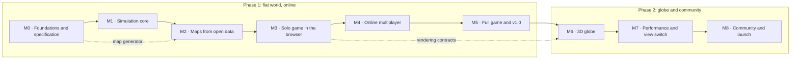

# Roadmap

Frontfall is built in two phases. Phase 1 (M0 to M5) delivers the complete game on a flat map that wraps east to west, playable online at [nclsmgr.com/frontfall](https://nclsmgr.com/frontfall/). Phase 2 (M6 to M8) puts the same game on a 3D globe and opens it to contributors. The rules do not change between the two: the globe is a new view, not a new game.

This page lists 71 issues across M1 to M8, about 197 days of focused work. Each milestone has a player outcome, a short list of checks that say when it is done, and the issues that get it there. Issues are tracked on the [milestones page](https://github.com/nic0lasm/frontfall/milestones).

## Overview

| Milestone                                                            | Phase | Player outcome                                                                                                       | Issues | Estimate    |
| -------------------------------------------------------------------- | ----- | -------------------------------------------------------------------------------------------------------------------- | ------ | ----------- |
| M0 · Foundations and specification                                   | 1     | Repository, rules specification, CI and deployment in place                                                          | 9      | In progress |
| [M1 · Simulation core](#m1--simulation-core)                         | 1     | A complete game of expansion and attacks runs headless and gives exactly the same result on every machine.           | 11     | 31 days     |
| [M2 · Maps from open data](#m2--maps-from-open-data)                 | 1     | Play on a recognisable Earth and on continent maps, with coasts and mountains, and no visible seam at the date line. | 8      | 22 days     |
| [M3 · Solo game in the browser](#m3--solo-game-in-the-browser)       | 1     | Open the site, pick a map, play a whole game against bots, and win or lose.                                          | 11     | 29 days     |
| [M4 · Online multiplayer](#m4--online-multiplayer)                   | 1     | Share a link, friends join, and the same game plays out on every screen.                                             | 9      | 29 days     |
| [M5 · Full game and v1.0](#m5--full-game-and-v10)                    | 1     | A complete strategy game: build, sail, strike, ally and betray. First public release.                                | 10     | 32 days     |
| [M6 · 3D globe](#m6--3d-globe)                                       | 2     | The same game on a planet you can spin. No edge, no seam.                                                            | 7      | 21 days     |
| [M7 · Performance and view switch](#m7--performance-and-view-switch) | 2     | Smooth on a modest laptop, and players switch between the flat map and the globe in the middle of a game.            | 8      | 20 days     |
| [M8 · Community and launch](#m8--community-and-launch)               | 2     | Players and contributors find the game, add maps and translations, and follow each release.                          | 7      | 13 days     |

A solid arrow means the later milestone cannot be finished before the earlier one. A dotted arrow marks work that starts early: the map generator (M2-01, M2-03) needs nothing from the engine and runs alongside M1, and the globe renderer (M6-01) can begin as soon as the rendering contracts of M3 (M3-01) exist.

## How to read the estimates

| Size | Meaning                                                  |
| ---- | -------------------------------------------------------- |
| S    | About 1 day                                              |
| M    | 2 to 3 days                                              |
| L    | 4 to 5 days. Anything larger is split before work starts |

Milestone estimates add up S = 1, M = 3 and L = 5 days. They measure scope, not a calendar: there are no dates on this page. A milestone is done when every check in its "Done when" list passes, not when its issues are closed.

Gameplay issues implement the rules of [`docs/rules.md`](rules.md) by identifier (`R-ATTACK-01`) and take every number from [`docs/balance.md`](balance.md). Architecture choices are recorded in [`docs/adr/`](adr/).

## M1 · Simulation core

**Outcome.** A complete game of expansion and attacks runs headless and gives exactly the same result on every machine.

**Done when**

1. A scripted 4-player game of 10,000 ticks on a 1,000 x 500 grid ends with the same state hash in Node.js, Chromium, Firefox and WebKit, checked in CI.
2. One tick on a 2,000,000-tile map with 32 players takes under 8 ms (median) on the CI runner.
3. Every `R-MAP`, `R-SPAWN`, `R-ECO` and `R-ATTACK` rule of `docs/rules.md` is covered by at least one test that names its identifier.
4. Engine line coverage stays at or above 90 %.

| ID    | Issue                                           | Size | Depends on   |
| ----- | ----------------------------------------------- | ---- | ------------ |
| M1-01 | Topology interface with flat and cylinder modes | M    | None         |
| M1-02 | Deterministic integer maths helpers             | S    | None         |
| M1-03 | Game state and tick loop                        | M    | M1-01, M1-02 |
| M1-04 | Intent validation and execution                 | M    | M1-03        |
| M1-05 | Spawn phase                                     | S    | M1-04        |
| M1-06 | Population, troops and gold growth              | M    | M1-03        |
| M1-07 | Expansion into neutral land                     | L    | M1-04, M1-06 |
| M1-08 | Attacks between players                         | L    | M1-07        |
| M1-09 | State hash and cross-runtime determinism suite  | M    | M1-08        |
| M1-10 | Run the engine in a Web Worker                  | M    | M1-04        |
| M1-11 | Headless runner and engine benchmark            | S    | M1-08        |

11 issues, about 31 days.

## M2 · Maps from open data

**Outcome.** Play on a recognisable Earth and on continent maps, with coasts and mountains, and no visible seam at the date line.

**Done when**

1. `pnpm maps` rebuilds every map byte for byte from pinned public-domain sources, checked by checksum in CI.
2. The World map is at least 2,048 x 1,024 tiles and its compressed download is under 2 MB.
3. Column 0 and the last column of every cylinder map join without a terrain break (automated test).
4. Each map ships with a manifest, a thumbnail and a line in `CREDITS.md`.

| ID    | Issue                                            | Size | Depends on          |
| ----- | ------------------------------------------------ | ---- | ------------------- |
| M2-01 | Map format v1 specification                      | S    | None                |
| M2-02 | Map loader in the engine                         | M    | M2-01, M1-03        |
| M2-03 | Map generator: land and water from Natural Earth | L    | M2-01               |
| M2-04 | Relief and impassable terrain                    | M    | M2-03               |
| M2-05 | Coasts, small islands and the east-west seam     | M    | M2-03               |
| M2-06 | Manifests, thumbnails and nation positions       | M    | M2-05               |
| M2-07 | First map set                                    | M    | M2-04, M2-05, M2-06 |
| M2-08 | Map build and checksum check in CI               | S    | M2-07               |

8 issues, about 22 days.

## M3 · Solo game in the browser

**Outcome.** Open the site, pick a map, play a whole game against bots, and win or lose.

**Done when**

1. From the menu to the end screen without a console error in current Chrome, Firefox and Safari (Playwright run in CI).
2. 60 frames per second on the World map at 1080p on the reference laptop (MacBook Air M1).
3. Five playtesters each finish a game without help; their notes are filed as issues.
4. Every interface string exists in English and French.

| ID    | Issue                                   | Size | Depends on   |
| ----- | --------------------------------------- | ---- | ------------ |
| M3-01 | Renderer and Camera contracts           | M    | M1-10        |
| M3-02 | Territory rendering with a data texture | L    | M3-01, M2-02 |
| M3-03 | Mouse, touch and keyboard input         | M    | M3-01        |
| M3-04 | In-game interface                       | M    | M3-02        |
| M3-05 | Main menu and game setup                | M    | M2-07        |
| M3-06 | Bots                                    | L    | M1-08, M1-05 |
| M3-07 | Nations                                 | M    | M3-06, M2-06 |
| M3-08 | Victory, defeat and end screen          | S    | M1-08        |
| M3-09 | English and French interface            | S    | None         |
| M3-10 | Settings and accessibility              | S    | M3-04        |
| M3-11 | First playtest round                    | S    | M3-08        |

11 issues, about 29 days.

## M4 · Online multiplayer

**Outcome.** Share a link, friends join, and the same game plays out on every screen.

**Done when**

1. Eight players on three browsers and two networks finish a game on `nclsmgr.com/frontfall` with zero desyncs.
2. A player who loses the connection for 30 seconds rejoins and catches up in under 10 seconds.
3. Load test: 20 games of 16 simulated players hold for 30 minutes under 50 % of one vCPU and 512 MB on the server.
4. Fuzzed and oversized messages never crash the server or affect other games.

| ID    | Issue                                               | Size | Depends on   |
| ----- | --------------------------------------------------- | ---- | ------------ |
| M4-01 | Protocol v1: version handshake and compact encoding | M    | None         |
| M4-02 | Lobby lifecycle                                     | M    | M4-01        |
| M4-03 | Public games list and private invite links          | M    | M4-02, M3-05 |
| M4-04 | Lockstep client                                     | L    | M1-10, M4-01 |
| M4-05 | Desync detection and reports                        | M    | M1-09, M4-04 |
| M4-06 | Reconnection and catch-up                           | L    | M4-04        |
| M4-07 | Abuse protection on the game server                 | M    | M4-02        |
| M4-08 | Server metrics and structured logs                  | S    | M4-02        |
| M4-09 | Load test and message fuzzing                       | M    | M4-04, M4-07 |

9 issues, about 29 days.

## M5 · Full game and v1.0

**Outcome.** A complete strategy game: build, sail, strike, ally and betray. First public release.

**Done when**

1. Every rule of `docs/rules.md` v1 is implemented and covered by a test that names it.
2. Tag `v1.0.0` with release notes, the matching image on GHCR and the build live on `nclsmgr.com/frontfall`.
3. The public server stays above 99 % uptime over the 14 days before the announcement, measured by an external check.
4. The README shows screenshots and a short clip of a real game.

| ID    | Issue                                       | Size | Depends on          |
| ----- | ------------------------------------------- | ---- | ------------------- |
| M5-01 | Structures: cities, ports and defence posts | L    | M3-04               |
| M5-02 | Transport boats and water pathfinding       | L    | M5-01               |
| M5-03 | Warships and naval combat                   | M    | M5-02               |
| M5-04 | Missiles and air defence                    | L    | M5-01               |
| M5-05 | Alliances, betrayal and embargoes           | M    | M3-04               |
| M5-06 | Team games                                  | M    | M4-02, M5-05        |
| M5-07 | Balance pass with headless games            | M    | M5-03, M5-04, M5-05 |
| M5-08 | Replays                                     | M    | M4-05               |
| M5-09 | Uptime monitoring and alerts                | S    | None                |
| M5-10 | Release v1.0                                | S    | M5-07, M5-08, M5-09 |

10 issues, about 32 days.

## M6 · 3D globe

**Outcome.** The same game on a planet you can spin. No edge, no seam.

**Done when**

1. A full multiplayer game is playable in the globe view with the same state hashes as the 2D view.
2. At every zoom level, a click on the globe selects the tile under the cursor (automated test on 1,000 random points).
3. No visible seam at 180 degrees and no texture stretching shown at the poles, which are ice caps.
4. 45 frames per second or more on the reference laptop at 1080p on the World map.

| ID    | Issue                                            | Size | Depends on   |
| ----- | ------------------------------------------------ | ---- | ------------ |
| M6-01 | Globe renderer on the Renderer contract          | M    | M3-01        |
| M6-02 | Territory texture on the sphere                  | M    | M6-01, M3-02 |
| M6-03 | Orbital camera                                   | M    | M6-01        |
| M6-04 | Ray-sphere picking                               | S    | M6-03, M1-01 |
| M6-05 | Units, structures and trajectories on the sphere | L    | M6-02, M5-04 |
| M6-06 | Labels and interface over the globe              | M    | M6-02        |
| M6-07 | Globe maps                                       | M    | M2-08        |

7 issues, about 21 days.

## M7 · Performance and view switch

**Outcome.** Smooth on a modest laptop, and players switch between the flat map and the globe in the middle of a game.

**Done when**

1. Budgets from `docs/performance.md` met on the reference laptop: 60 fps in 2D, 45 fps on the globe, 1080p, World map, 64 players.
2. Tick p95 under 8 ms for 64 players on the 4,096 x 2,048 map.
3. Client memory under 500 MB; first load under 5 MB compressed before the map.
4. Switching view keeps the game running and takes under 500 ms.

| ID    | Issue                                           | Size | Depends on   |
| ----- | ----------------------------------------------- | ---- | ------------ |
| M7-01 | Performance budget and reference hardware       | S    | None         |
| M7-02 | Benchmark regression gate in CI                 | M    | M7-01, M1-11 |
| M7-03 | Engine hot paths                                | L    | M7-02        |
| M7-04 | Cheaper updates from the worker to the renderer | M    | M7-02        |
| M7-05 | Rendering levels of detail                      | M    | M6-05        |
| M7-06 | Graphics quality settings                       | S    | M7-05        |
| M7-07 | Switch between map and globe during a game      | M    | M6-04, M7-04 |
| M7-08 | Download size and load time                     | S    | M6-01        |

8 issues, about 20 days.

## M8 · Community and launch

**Outcome.** Players and contributors find the game, add maps and translations, and follow each release.

**Done when**

1. A person outside the project adds a map by following the guide alone, and it is merged.
2. At least 10 open issues labelled `good first issue`, each with a clear scope and pointers.
3. Each tag publishes release notes generated from the commit history.
4. The launch announcement is published on the planned channels.

| ID    | Issue                          | Size | Depends on   |
| ----- | ------------------------------ | ---- | ------------ |
| M8-01 | Map contribution workflow      | M    | M2-08        |
| M8-02 | Translation workflow           | S    | M3-09        |
| M8-03 | Release notes automation       | S    | None         |
| M8-04 | Good first issues backlog      | S    | None         |
| M8-05 | Contributor architecture guide | M    | None         |
| M8-06 | Game landing and about page    | M    | M5-10        |
| M8-07 | Launch announcement            | S    | M7-07, M8-06 |

7 issues, about 13 days.

## Not planned yet

Player accounts, ranked matchmaking, cosmetics and payments, native mobile apps and servers in several regions are left out on purpose. They will be considered after v1.0 based on what players ask for in [Discussions](https://github.com/nic0lasm/frontfall/discussions).

## Legal

Frontfall is an independent game inspired by browser territory games such as OpenFront. It is not affiliated with or endorsed by OpenFront and contains no code, assets or text from it. Map data comes from public-domain sources listed in [`CREDITS.md`](../CREDITS.md).
